# 03 — Dan's solver, line by line

This chapter walks through `mom6_forge/_conformal.py` as it stands in PR #151 (worktree
`conformal-solver`, head `db0db39`), plus `Grid.from_outline` in `grid.py`, in the order the
code runs. For each function: what it does, the math behind it, and the tricks that aren't
obvious from reading it. Section 14 covers what the full PR #149 adds (corner refinement and
the preview solve). Section 15 lists things worth raising in review. Every observation there was
checked by running the code.

- **Background:** [01_the_problem.md](01_the_problem.md) defines the conformal map, the modulus
  $M$ and what the projection changes. [02_gridgen_method.md](02_gridgen_method.md) is the
  Schwarz–Christoffel route that gridgen takes; its §5 sets the two methods side by side.
- **Pictures:** [walkthrough_dans_solver.ipynb](walkthrough_dans_solver.ipynb) runs each stage on a
  trapezoid and on California, using the private functions directly. The figures below come from it.
- **Credit:** the solver is Dan Amrhein's. In the literature this approach (two Laplace solves
  with swapped boundary conditions, then the modulus from their energies) is called the
  *conjugate function method* (Hakula, Quach and Rasila, 2013).
- **Numbers** were measured on `db0db39` in the `dev_mf` env, with the 30-vertex California outline
  `tests/data/california_bays.outline.json` (corners `[0, 6, 22, 29]`) and 12,000 cells unless stated.

Line links point into the worktree: `L393` means
[`_conformal.py` line 393](../../../regional_mom_workflows/mom6_forge-worktrees/conformal-solver/mom6_forge/_conformal.py#L393).

---

## 0. The pipeline on one page

```
 lon, lat (outline, degrees), 4 corner indices, n_cells
        │
        ▼
 _validate_and_orient ── unwrap dateline / detect pole, simple?, make CCW      L347
        │
 as_projection ── pick a conformal map projection (lcc, merc, tmerc, stere)     L195
        │  to_xy
        ▼
 P (outline in metres) ── h = √(area / raster_points)   (California: 1.09 km)   L463
        │  order_corners: SW first, then CCW → sides S, E, N, W
        ▼
 _sides ── boundary nodes ≤ h apart on each side, every vertex kept             L375
        │
 _mesh ── interior: square lattice, 2 right triangles per square                L393
        │  near the outline: scipy Delaunay of a 3h-wide band
        ▼        (California: 251,287 nodes, 500,014 triangles; Delaunay on only 8,887)
 _stiffness ── P1 Laplacian K (in the lattice it is the 5-point stencil)        L426
        │
 _harmonic ×2 ── ξ: 0 on W, 1 on E      η: 0 on S, 1 on N      (zero flux on    L438
        │         the other two sides)  → nodal fields and energies E_ξ, E_η
        ▼
 aspect M = √(E_ξ/E_η) ── nx = √(n_cells/M), ny = M·nx    (63 × 193)            L471
        │
 _sample ── inverse map: (x, y) at the uniform (ξ, η) supergrid lattice,        L480
        │    interpolated inside the image of each mesh triangle
        ▼
 solve ── snap outer rows/columns onto the sides, pin the 4 corners,            L509
        │   unproject to lon/lat
        ▼
 ConformalGrid (supergrid lon, lat, x, y; nx, ny, aspect, h, corners, ...)
        │
 Grid.from_outline ── choose projection by size_ratios, build a Grid           grid.py L645
                      (haversine metrics), remember the outline
```

Time for the full California solve at the default 250k mesh is 1.9 s: mesh 0.21 s, stiffness
0.13 s, the two sparse direct solves 1.46 s, sampling 0.10 s.

The ideas that carry the method:

1. **Two linear problems give an orthogonal grid.** $\xi$ and $\eta$ are harmonic with swapped
   Dirichlet and zero-flux sides. Uniqueness makes them conjugate, $\xi + iM\eta$ analytic, so
   their level sets cross at right angles. Nobody solves the Cauchy–Riemann equations directly.
2. **The energies give the shape.** $E_\xi = M$ and $E_\eta = 1/M$ exactly. Finite-element
   energies are upper bounds, so $1/E_{\eta,h} \le M \le E_{\xi,h}$ brackets the modulus.
3. **Solve forward, invert by interpolation.** The Laplace problem is solved in physical space,
   where it's linear. The grid is then read off by inverting the piecewise-linear map triangle
   by triangle. Classical elliptic grid generation (Winslow, Thompson) instead solves the
   nonlinear inverse equations for $x(\xi,\eta)$.
4. **A cheap mesh.** 97% of the triangles are lattice half-squares, for which the FE matrix is
   exactly the 5-point Laplacian. Only a thin band along the outline needs a real (Delaunay)
   triangulation.

---

## 1. The projection plane: `MapProjection`, `projection_for`, `as_projection`

**Why a projection at all.** The Laplace solves happen in a flat plane. Any projection would give
an orthogonal grid *in the plane*. Only a **conformal** projection keeps it orthogonal on the
Earth, because a conformal map composed with a conformal map is still conformal. A conformal
projection scales lengths by the same factor $k$ in every direction at a point. So square cells
in the plane are square on the Earth too; they are just $1/k$ the size. An equal-area or
equidistant projection would shear them.
[01 §1.7](01_the_problem.md) has the longer version.

**`MapProjection`** ([L36–102](../../../regional_mom_workflows/mom6_forge-worktrees/conformal-solver/mom6_forge/_conformal.py#L36))
is a dataclass holding `kind` ∈ {lcc, merc, tmerc, stere}, `lon_0`, `lat_0` and optional
`lat_1`, `lat_2`.
- `proj4` ([L66](../../../regional_mom_workflows/mom6_forge-worktrees/conformal-solver/mom6_forge/_conformal.py#L66))
  writes the PROJ string, on the WGS84 ellipsoid. All four are ellipsoidal conformal projections.
- `_proj` ([L91–94](../../../regional_mom_workflows/mom6_forge-worktrees/conformal-solver/mom6_forge/_conformal.py#L91))
  caches a `pyproj.Proj`. The comment says it is 70× cheaper to build than a `Transformer`.
- `cartopy()` exists only for plotting.

**`projection_for(kind, lon, lat)`** ([L132–192](../../../regional_mom_workflows/mom6_forge-worktrees/conformal-solver/mom6_forge/_conformal.py#L132))
centres a projection on the outline:
- `lon_0` is the mean of the *unwrapped* longitudes, wrapped back to [−180, 180)
  ([L171](../../../regional_mom_workflows/mom6_forge-worktrees/conformal-solver/mom6_forge/_conformal.py#L171)).
  Without the unwrap, an outline straddling the dateline would be centred on the wrong side of
  the globe.
- `"auto"` ([L174–175](../../../regional_mom_workflows/mom6_forge-worktrees/conformal-solver/mom6_forge/_conformal.py#L174))
  is a latitude rule:
  - polar stereographic if the mean latitude is above 65°;
  - Mercator if the outline crosses or is within 15° of the equator;
  - Lambert conformal conic otherwise.
- LCC puts its standard parallels at 1/6 and 5/6 of the latitude span (the classic rule for conic
  projections), and refuses an outline centred on the equator, where the cone would be flat.
- Mercator has true scale on the equator (`lat_ts=0`). Transverse Mercator uses `k=1` on `lon_0`.
  Stereographic is always *polar* (centred on ±90°) with true scale at ±70°.

**`as_projection`** ([L195–225](../../../regional_mom_workflows/mom6_forge-worktrees/conformal-solver/mom6_forge/_conformal.py#L195))
turns the `projection=` argument into a `MapProjection`:
- `None`/`"auto"` → `projection_for("auto")`;
- a kind name → that kind, centred on the outline;
- a `MapProjection` → returned unchanged, unless the outline encloses a pole and the projection
  isn't stereographic, in which case it raises.

**What the choice actually changes.** By uniqueness of the conformal map, all conformal
projections would give the same grid on the Earth *if they saw the same region*. They don't
quite, because a straight edge between two outline vertices is a different curve on the Earth in
each plane. I re-checked this on California (also done in
[`projection_invariance.ipynb`](projection_invariance.ipynb)). Densify the outline every 5 km
along geodesics, and the aspect agrees to 4 digits in all four projections (3.0543–3.0545, all
63 × 192). With the raw 30-vertex outline it doesn't:

| kind | lcc | merc | tmerc | stere |
|---|---|---|---|---|
| aspect | 3.0556 | 2.9888 | 3.0584 | 3.1082 |
| nx × ny | 63 × 193 | 63 × 188 | 63 × 193 | 62 × 193 |

So the projection mostly decides how the long offshore edges are drawn.

## 2. The dateline and the poles: `_lon_steps`, `_pole_contained`, `unwrap_lon`

- **`_lon_steps`** ([L105](../../../regional_mom_workflows/mom6_forge-worktrees/conformal-solver/mom6_forge/_conformal.py#L105))
  is the longitude step from each vertex to the next, wrapped into [−180, 180) by
  `(Δ + 180) % 360 − 180`. Every step is taken the short way round.
- **`_pole_contained`** ([L111](../../../regional_mom_workflows/mom6_forge-worktrees/conformal-solver/mom6_forge/_conformal.py#L111))
  sums those steps around the closed ring. This is a winding number in disguise:
  - an outline that doesn't go round a pole sums to 0;
  - one that does sums to ±360.

  The threshold is 180°. Which pole is decided by the sign of the mean latitude.
- **`unwrap_lon`** ([L118](../../../regional_mom_workflows/mom6_forge-worktrees/conformal-solver/mom6_forge/_conformal.py#L118))
  rebuilds the longitudes as `lon[0] + cumsum(steps)`, so no consecutive pair differs by more
  than 180°. `[170, −170]` becomes `[170, 190]`. `[170, 190]` and `[170, −170]` unwrap the same
  way, which is why the test `test_dateline_signed_and_0_360_longitudes_agree` passes.
- **Round a pole** no unwrapping exists (the steps sum to 360°), so `unwrap_lon` raises. Instead:
  - `projection_for` returns a polar stereographic projection centred on the pole, with `lon_0`
    the *circular* mean of the longitudes
    ([L168–170](../../../regional_mom_workflows/mom6_forge-worktrees/conformal-solver/mom6_forge/_conformal.py#L168)).
    That needs no unwrapping.
  - In the plane, the pole is just an interior point, and the outline is an ordinary polygon
    around it.
  - At the end of `solve`, latitudes are clipped to ±(90 − 1e-6)
    ([L569](../../../regional_mom_workflows/mom6_forge-worktrees/conformal-solver/mom6_forge/_conformal.py#L569)).
    A node that lands exactly on the pole would otherwise have an undefined longitude.
- **Dateline in the output.** `to_lonlat` returns longitudes in [−180, 180], so a grid across the
  dateline comes back with a 360° jump between neighbours (the Aleutians test box: 359.3°).
  `solve` doesn't fix that. `SupergridBase._init_from_xy`, inside `Grid.from_lonlat_arrays`,
  repairs the seam: the same box comes out of `Grid.from_outline` with `qlon` in [170, 190].

## 3. Checking and orienting the outline: `_validate_and_orient` and the polygon helpers

**`_validate_and_orient`** ([L347–372](../../../regional_mom_workflows/mom6_forge-worktrees/conformal-solver/mom6_forge/_conformal.py#L347))
first checks the inputs:
- at least 4 vertices;
- exactly 4 distinct corner indices, in range;
- the 4 corners at 4 different places.

Then it branches:
- **No pole:** unwrap, check the polygon is simple in (unwrapped) lon/lat, and orient it
  counter-clockwise.
- **Round a pole:** project to a nominal polar stereographic plane and judge simplicity and
  winding there
  ([L366–372](../../../regional_mom_workflows/mom6_forge-worktrees/conformal-solver/mom6_forge/_conformal.py#L366)).
  Only lon/lat get reversed; the corners are remapped by `orient_ccw`.

Note that simplicity is judged in lon/lat, not in the plane the solve uses. §15.6 shows why that
matters.

The polygon helpers:

- **`_signed_area`** ([L228](../../../regional_mom_workflows/mom6_forge-worktrees/conformal-solver/mom6_forge/_conformal.py#L228))
  is the shoelace formula, positive for counter-clockwise. Orientation is the same in lon/lat and
  in any of the four projections: they all preserve orientation, with x east and y north.
- **`is_simple`**: shapely `LinearRing.is_simple`.
- **`orient_ccw`** ([L240](../../../regional_mom_workflows/mom6_forge-worktrees/conformal-solver/mom6_forge/_conformal.py#L240))
  reverses a clockwise ring and maps each corner index $c \mapsto n-1-c$.
- **`interior_angles`** ([L250](../../../regional_mom_workflows/mom6_forge-worktrees/conformal-solver/mom6_forge/_conformal.py#L250))
  is 180° minus the turning angle `atan2(cross, dot)` of the incoming and outgoing edges. A
  reflex vertex (one poking into the domain) has a negative turn, so its interior angle is above
  180°.
- **`order_corners`** ([L260](../../../regional_mom_workflows/mom6_forge-worktrees/conformal-solver/mom6_forge/_conformal.py#L260))
  makes the corner with the smallest $x+y$ the "SW" corner, then takes the others in ring order.
  The ring is CCW, so that gives SW → SE → NE → NW, and side $k$ runs from corner $k$ to
  corner $k+1$: 0 = S, 1 = E, 2 = N, 3 = W.

**S/E/N/W are logical labels, not compass directions.** On California, "W" is the offshore line,
"E" is the coast from Los Angeles to the East Bay, and the 193-cell $\eta$ direction runs along
the coast.

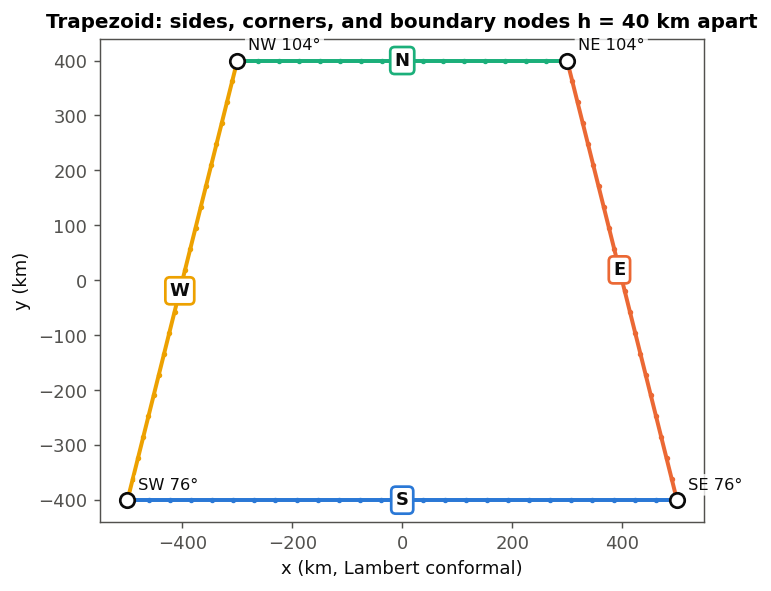

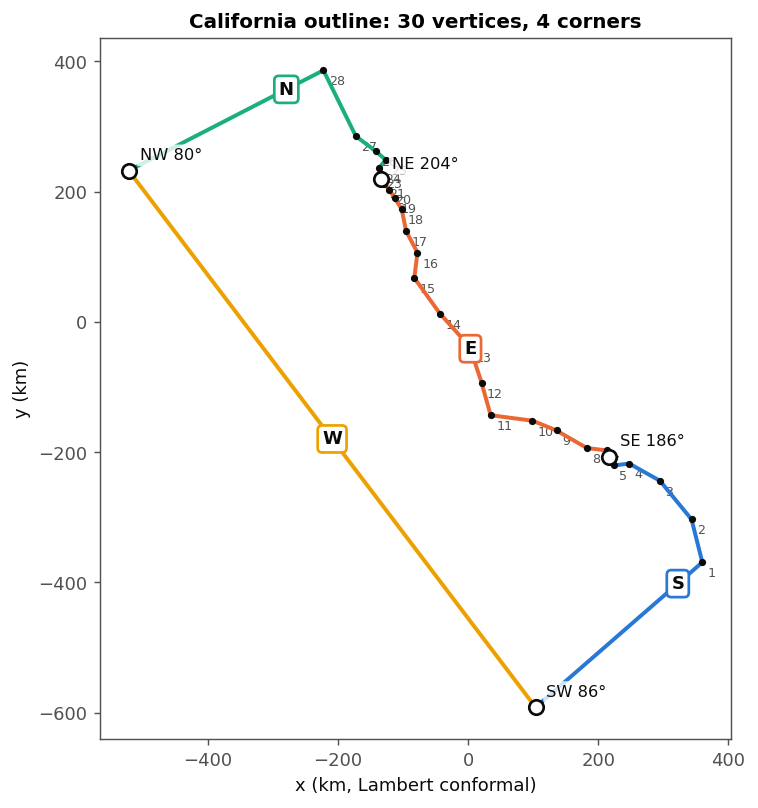

## 4. Boundary nodes: `_sides`

[L375–390](../../../regional_mom_workflows/mom6_forge-worktrees/conformal-solver/mom6_forge/_conformal.py#L375).
For each side, the function:
1. takes the outline vertices from corner $k$ to corner $k+1$, wrapping the index
   ([L381](../../../regional_mom_workflows/mom6_forge-worktrees/conformal-solver/mom6_forge/_conformal.py#L381));
2. drops consecutive duplicates
   ([L382](../../../regional_mom_workflows/mom6_forge-worktrees/conformal-solver/mom6_forge/_conformal.py#L382)),
   so a zero-length segment can't produce a 0/0;
3. splits each segment into `ceil(seg/h)` equal parts.

It returns the points and their arclength `s` from the side's first corner, both corners
included.

All vectorised with `np.repeat`:
- `e` is the segment index of each new point;
- `t` is the fraction along that segment
  ([L385–388](../../../regional_mom_workflows/mom6_forge-worktrees/conformal-solver/mom6_forge/_conformal.py#L385)).

Two properties matter later:
- **Every outline vertex is a mesh node**, so the mesh boundary *is* the polygon. Checked on
  California: the triangle areas sum to the polygon's area to $2\times10^{-16}$ relative, and no
  triangle sticks out. This settles the open item in [02 §7](02_gridgen_method.md) about whether
  the mesh domain matches the polygon near reflex vertices.
- **Boundary spacing is at most $h$.** The Delaunay band in §5 relies on boundary nodes being no
  sparser than the lattice.

`s` is what `solve` later uses to place the outer row of grid nodes along each side (§10).

## 5. The mesh: `_mesh`

[L393–423](../../../regional_mom_workflows/mom6_forge-worktrees/conformal-solver/mom6_forge/_conformal.py#L393).
The goal is a triangulation of the polygon with about `raster_points` nodes, built in well under
a second for 250k nodes. Dan's trick: a structured lattice for the interior, and a real
triangulation only where it is needed.

**Node numbering.** The nodes go in this order
([L396–398](../../../regional_mom_workflows/mom6_forge-worktrees/conformal-solver/mom6_forge/_conformal.py#L396), [L411](../../../regional_mom_workflows/mom6_forge-worktrees/conformal-solver/mom6_forge/_conformal.py#L411)):
1. the 4 corners, so corner $k$ is node $k$;
2. each side's interior points, in side order;
3. the lattice nodes that are used.

`ids[k] = [k, side-k points…, k+1]` lists the node ids along side $k$, both corners included.

**The lattice and the distance field**
([L399–404](../../../regional_mom_workflows/mom6_forge-worktrees/conformal-solver/mom6_forge/_conformal.py#L399)).
- Lattice points sit at `P.min + h/2 + h·(i, j)`.
- For points inside the polygon (matplotlib `Path.contains_points`), $d$ is the distance to the
  outline divided by $h$, from shapely. Outside, $d = 0$.
- Since $h = \sqrt{\text{area}/\text{raster\_points}}$, about `raster_points` lattice points fall
  inside. California has exactly 250,000.

**Three thresholds on $d$.** Each is the smallest round number that makes a geometric argument
work.

| threshold | line | what it does | why that value |
|---|---|---|---|
| $d > 0.5$ | [L405](../../../regional_mom_workflows/mom6_forge-worktrees/conformal-solver/mom6_forge/_conformal.py#L405) | keep a lattice node only if it is at least $h/2$ from the outline | Boundary nodes are up to $h$ apart. A lattice node closer than $h/2$ would make sliver triangles with them. (California: 1,271 of 250,000 dropped.) |
| $d > 1.5$ for all 4 corners | [L407–408](../../../regional_mom_workflows/mom6_forge-worktrees/conformal-solver/mom6_forge/_conformal.py#L407) | the square is "full": meshed as 2 right triangles | It makes the square's circumcircle empty (next paragraph). Needs $d > \sqrt2 \approx 1.41$. |
| $d < 3$ | [L414](../../../regional_mom_workflows/mom6_forge-worktrees/conformal-solver/mom6_forge/_conformal.py#L414) | lattice nodes that go into the Delaunay band | Every node on the edge of the full-square region must be in the band. Needs $d > 1.5 + \sqrt2 \approx 2.91$. |

**Why the comment can say "the squares' edges are Delaunay edges"**
([L412–413](../../../regional_mom_workflows/mom6_forge-worktrees/conformal-solver/mom6_forge/_conformal.py#L412)).
A Delaunay triangulation is the one where no node lies inside any triangle's circumcircle. If 4
nodes lie on a circle with no other node inside it, the edges between neighbours on that circle
appear in *every* Delaunay triangulation. Take a full square of side $h$:
- **Its circumcircle** has radius $r = h/\sqrt2$.
- **No outline node is inside it.** Each corner is more than $1.5h$ from the outline, so the
  centre is more than $1.5h - r \approx 0.79h$ away, which is more than $r$.
- **No lattice node is inside it.** The nearest other lattice points are $1.58h$ from the centre.

So the 4 edges of every full square whose corners are in the band are Delaunay edges, and no
Delaunay triangle can cross them.

**Every Delaunay triangle is either inside a square or outside all of them.**
- Every node on the edge of the full-square region is a corner of some non-full square. That
  square has a corner within $1.5h$ of the outline, at most $\sqrt2 h$ away, so the node has
  $d < 2.91$ and is in the band.
- So the full-square region is fenced by Delaunay edges.
- Nodes with $d \ge 3$ are surrounded by full squares, since their neighbours are all beyond
  $1.59h$. Nothing is lost by leaving them out of the Delaunay.

**Dropping triangles by centroid**
([L416–422](../../../regional_mom_workflows/mom6_forge-worktrees/conformal-solver/mom6_forge/_conformal.py#L416)).
`scipy.spatial.Delaunay` triangulates the band's convex hull. That includes the full squares
(with whichever diagonal qhull picks), bridges across the deep interior, and pieces outside the
polygon. The code drops three kinds of triangle:
- **centroid in a full square** (looked up by `floor((c − lo)/h)` in the padded `full` array).
  By the argument above, such a triangle is entirely in the square region, and the code adds its
  own fixed-diagonal halves instead;
- **centroid outside the polygon**;
- **degenerate** (area below $10^{-9}h^2$).

On California at 250k: 16,062 Delaunay triangles; 4,154 dropped as in a square, 848 as outside,
11,060 kept; plus 488,954 square halves.

**The centroid test is a heuristic.** The Delaunay is not constrained to the outline, so a kept
triangle can poke out of the polygon where two parts of the outline come within about $h$ of each
other. §15.7 shows when this actually happens.

**Cost.** Delaunay runs on 8,887 of 251,287 nodes. The whole mesh takes 0.21 s.

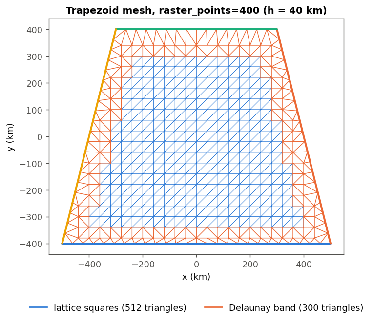

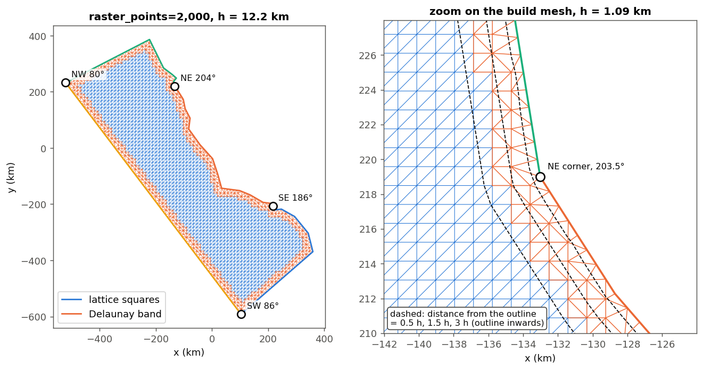

## 6. The stiffness matrix: `_stiffness`

[L426–435](../../../regional_mom_workflows/mom6_forge-worktrees/conformal-solver/mom6_forge/_conformal.py#L426).
**P1 finite elements:** the unknown $u$ is one value per node, linear on each triangle. The
discrete Laplace problem minimises $\int|\nabla u_h|^2$, which is the quadratic form
$u^T K u$ with

$$K_{ij} = \int \nabla\phi_i\cdot\nabla\phi_j\,dA ,$$

where $\phi_i$ is the "hat" function: 1 at node $i$, 0 at all other nodes.

**The element entry.** In a triangle with vertices $x_1, x_2, x_3$ (indices mod 3), let
$e_i = x_{i+1} - x_{i-1}$, the edge *opposite* vertex $i$. In code this is
`nodes[roll(tri,-1)] - nodes[roll(tri,1)]` ([L428](../../../regional_mom_workflows/mom6_forge-worktrees/conformal-solver/mom6_forge/_conformal.py#L428)).

- $\phi_i$ is 0 along $e_i$ and 1 at the vertex across from it, at distance (height)
  $2A/|e_i|$. So $\nabla\phi_i$ is perpendicular to $e_i$ with magnitude $|e_i|/(2A)$:
  $\nabla\phi_i = \pm R\,e_i/(2A)$, with $R$ the 90° rotation and the same sign for all three.
- $\nabla\phi_i$ is constant on the triangle, so
$$k_{ij} = A\,\frac{(Re_i)\cdot(Re_j)}{4A^2} = \frac{e_i\cdot e_j}{4A}.$$
- The code's `area2` is $|{\rm cross}| = 2A$, and it divides by `2 * area2` $= 4A$
  ([L429–430](../../../regional_mom_workflows/mom6_forge-worktrees/conformal-solver/mom6_forge/_conformal.py#L429)).
  The absolute value matters: qhull does not promise a consistent orientation for its simplices.

**Off-diagonal entries as a cotangent.** For $i\ne j$, $e_i$ and $e_j$ meet at the third vertex
$k$: one leaves it, the other arrives. So $e_i\cdot e_j = -|e_i||e_j|\cos\theta_k$, while
$2A = |e_i||e_j|\sin\theta_k$. Hence

$$k_{ij} = -\tfrac12\cot\theta_k ,$$

the classic cotangent formula. Assembled over the two triangles sharing edge $ij$, the global
entry is $-\tfrac12(\cot\alpha + \cot\beta)$, with $\alpha$ and $\beta$ the two angles facing
the edge.

**Why right-triangle hypotenuses vanish.** The angle facing the hypotenuse is 90°, and
$\cot 90° = 0$. On the lattice this is exact in floating point. The two legs are axis-aligned,
with exactly equal x in a column and equal y in a row, so the dot product is $0\cdot h + h\cdot 0$.
Both halves of a square contribute 0 to the diagonal pair, and `eliminate_zeros`
([L434](../../../regional_mom_workflows/mom6_forge-worktrees/conformal-solver/mom6_forge/_conformal.py#L434))
removes those stored zeros. That keeps the sparsity, not the answer.

**What remains in the lattice is the 5-point stencil.** Each axis edge faces two 45° angles:
$-\tfrac12(1+1) = -1$. The row sum is 0. So a lattice row is $[4, -1, -1, -1, -1]$, with no $h$,
because the 2D Dirichlet integral is scale-free. I checked this on the test rectangle:
the centre-node row is exactly $[4,-1,-1,-1,-1]$. For 97% of the domain, then, this "finite
element" solve is the standard finite-difference Laplacian. The FE formulation only earns its keep
in the band, where it handles arbitrary triangles and gives the zero-flux condition for free (§7).

**A discrete maximum principle.** If every off-diagonal entry is $\le 0$ ($K$ is an M-matrix),
the discrete solution can't have an interior max or min.
- **Interior edges:** the entry is $\le 0$ exactly when $\alpha+\beta\le\pi$, which is the
  Delaunay condition. Square edges face 45° angles.
- **Outline edges:** they have only one triangle, so their entry goes positive if that triangle
  is obtuse opposite the outline.

California has **zero** positive off-diagonals at 1k, 20k and 250k nodes, and $\xi_h, \eta_h$
stay inside [0, 1].

## 7. The two Laplace solves: `_harmonic`

[L438–451](../../../regional_mom_workflows/mom6_forge-worktrees/conformal-solver/mom6_forge/_conformal.py#L438).
`_solve_mesh` calls it twice
([L469–470](../../../regional_mom_workflows/mom6_forge-worktrees/conformal-solver/mom6_forge/_conformal.py#L469)):

| field | value 0 on | value 1 on | zero normal flux on |
|---|---|---|---|
| $\xi$ | W (`ids[3]`) | E (`ids[1]`) | S, N |
| $\eta$ | S (`ids[0]`) | N (`ids[2]`) | E, W |

Each corner is in two `ids` lists, so it gets the Dirichlet value of both fields. The SW corner
has $(\xi,\eta) = (0,0)$, and so on.

**Dirichlet vs natural boundary conditions.**
- A **Dirichlet** node is fixed. The system is split as $A u_{\rm free} = -B u_{\rm fixed}$
  ([L447–448](../../../regional_mom_workflows/mom6_forge-worktrees/conformal-solver/mom6_forge/_conformal.py#L447)),
  then solved with `spsolve`, a sparse direct LU.
- A **zero-flux** side needs no code at all. Minimising $u^TKu$ with those nodes free makes
  $\partial u/\partial n = 0$ the *natural* boundary condition of the variational problem. In FD
  terms, a boundary node's row just sums its own (half-cell) triangles, with no ghost points.

**Why these boundary conditions give orthogonal grid lines.** Let $M$ be the modulus (§8). The
exact map $w = \xi + iM\eta$ is analytic, and the Cauchy–Riemann equations give

$$\nabla\xi = M\,R\nabla\eta, \qquad \nabla\xi\perp\nabla\eta, \qquad |\nabla\xi| = M|\nabla\eta|.$$

Along a side where $\xi$ has zero normal derivative, Cauchy–Riemann makes the *tangential*
derivative of $\eta$ zero, so $\eta$ is constant there. That is exactly why each field is
Dirichlet where the other is zero-flux. Two independent solves with complementary conditions
produce a conjugate pair, because the exact solutions are unique.

**The energy and the NaN.**
- `energy = u @ (K @ u)`
  ([L449](../../../regional_mom_workflows/mom6_forge-worktrees/conformal-solver/mom6_forge/_conformal.py#L449))
  is $\int|\nabla u_h|^2$, the discrete Dirichlet energy.
- A node in no triangle has an all-zero row, which would make $A$ singular. `free` therefore
  excludes nodes with `K.diagonal() == 0`
  ([L446](../../../regional_mom_workflows/mom6_forge-worktrees/conformal-solver/mom6_forge/_conformal.py#L446)).
  Their value is set to NaN afterwards
  ([L450](../../../regional_mom_workflows/mom6_forge-worktrees/conformal-solver/mom6_forge/_conformal.py#L450)),
  so later code can skip them (`np.isfinite` in `solve`).
- I found no orphan node on any outline I tried, including the badly bridged ones in §15.7. It is
  a safety net.

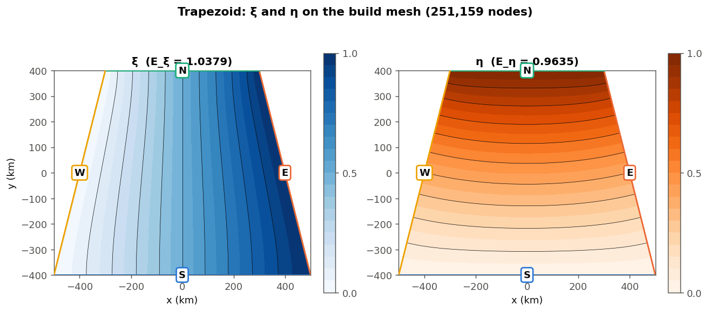

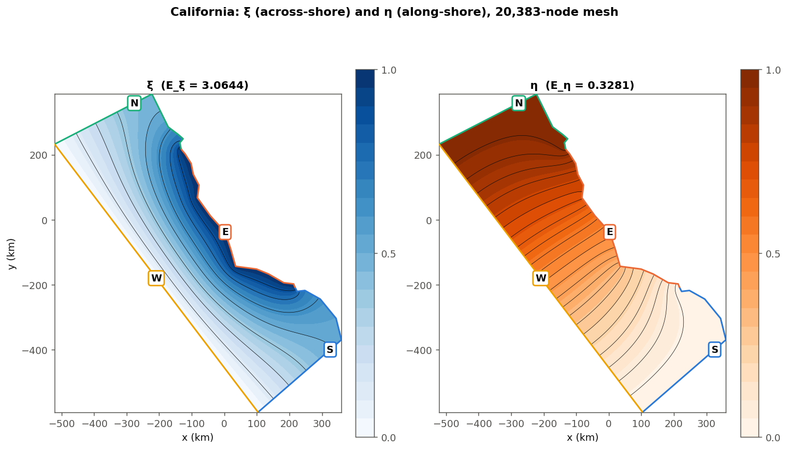

## 8. Modulus and cell counts: `_solve_mesh`

[L454–477](../../../regional_mom_workflows/mom6_forge-worktrees/conformal-solver/mom6_forge/_conformal.py#L454)
chains §3–7 and returns everything in a dict. The steps:
1. **Sliver guard**
   ([L461](../../../regional_mom_workflows/mom6_forge-worktrees/conformal-solver/mom6_forge/_conformal.py#L461)):
   perimeter < 200·√area. That is an isoperimetric ratio: 4 for a square, 200 for about a
   10⁴ : 1 rectangle. It is written as `not (… < …)`, so a NaN perimeter also raises.
2. **$h = \sqrt{\text{area}/\text{raster\_points}}$**
   ([L463](../../../regional_mom_workflows/mom6_forge-worktrees/conformal-solver/mom6_forge/_conformal.py#L463)).
3. **`corner_angles`** from `interior_angles`
   ([L465](../../../regional_mom_workflows/mom6_forge-worktrees/conformal-solver/mom6_forge/_conformal.py#L465)).
   They are only reported.
4. **Mesh, stiffness, the two fields, then aspect and cell counts.**

**Why $\sqrt{E_\xi/E_\eta}$ is the modulus.**
- Map the region conformally onto a rectangle $W$ wide (W→E) and $H$ tall, with $M = H/W$.
- On the rectangle, $\xi = x/W$ and $\eta = y/H$, so
  $E_\xi = \int|\nabla\xi|^2 = WH/W^2 = M$ and $E_\eta = 1/M$.
- The 2D Dirichlet energy is invariant under conformal maps: $|\nabla u|^2$ picks up $|f'|^2$ and
  $dA$ picks up $|f'|^{-2}$. So the same values hold on the original region.
- Hence $\sqrt{E_\xi/E_\eta} = M$, and $E_\xi E_\eta = 1$. ([01 §1.5](01_the_problem.md) gives the
  electrical-conductance reading of this.)

**Why both energies, not just $E_\xi$: they bracket $M$.** The exact $\xi$ minimises the
energy among functions with its boundary values. The FE $\xi_h$ minimises it over a *subset*
(piecewise-linear functions). Here that subset is genuinely smaller, not just different: the 0/1
data are exactly representable, and the mesh covers exactly the polygon (§4). So
$E_{\xi,h} \ge E_\xi = M$. The same argument for $\eta$ gives $E_{\eta,h} \ge 1/M$. Together:

$$\frac{1}{E_{\eta,h}} \;\le\; M \;\le\; E_{\xi,h},$$

and `aspect = sqrt(e_xi / e_eta)`
([L471](../../../regional_mom_workflows/mom6_forge-worktrees/conformal-solver/mom6_forge/_conformal.py#L471))
is the geometric mean of the two bounds. Two consequences:
- **The product is an error gauge.** $E_{h} - E = \|\nabla(u-u_h)\|^2$ (Galerkin orthogonality),
  so $E_{\xi,h}E_{\eta,h}-1$ is roughly the sum of the two relative squared energy errors.
- **The ratio is much better than either bound.** On California the two errors nearly cancel:

| raster_points | $E_\xi$ (upper) | $1/E_\eta$ (lower) | aspect | $E_\xi E_\eta - 1$ |
|---|---|---|---|---|
| 1,000 | 3.0911 | 3.0209 | 3.0558 | 2.3e-2 |
| 20,000 | 3.0644 | 3.0474 | 3.0559 | 5.6e-3 |
| 250,000 | 3.0581 | 3.0531 | 3.0556 | 1.7e-3 |

The bracket is 2.3% wide at 1k points, yet the aspect is already right to 4 digits.

The product error falls like $h^{0.96}$, not $h^2$. Corner singularities (§14) limit P1
convergence: the 204° corner alone predicts $h^{2\lambda} = h^{0.88}$ with
$\lambda = 90/203.5$. The 1000 × 600 km test rectangle is exact ($E_\xi = 0.600000000000$),
because linear elements reproduce its linear $\xi$.

**From aspect to nx, ny**
([L473–474](../../../regional_mom_workflows/mom6_forge-worktrees/conformal-solver/mom6_forge/_conformal.py#L473)).
A cell spans $1/n_x$ in $\xi$ and $1/n_y$ in $\eta$. Its physical width is about
$1/(n_x|\nabla\xi|)$ and its height about $1/(n_y|\nabla\eta|) = M/(n_y|\nabla\xi|)$. Square cells
need $n_y = M n_x$. With $n_xn_y = N$ that gives:
- `nx = round(sqrt(N/M))` and `ny = round(nx·M)`, each at least 1.
- California: $\sqrt{12000/3.0556} = 62.7 \to 63$, and $63 \times 3.0556 = 192.5 \to 193$:
  **12,159 cells**.
- ny is rounded from the rounded nx, so $n_xn_y$ can miss $N$ by a few per cent.

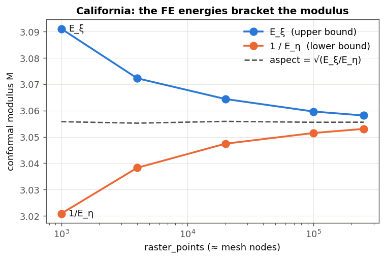

## 9. Inverting the map: `_sample`

[L480–506](../../../regional_mom_workflows/mom6_forge-worktrees/conformal-solver/mom6_forge/_conformal.py#L480).

**The math.**
- On each triangle the discrete map $(x,y)\mapsto(\xi_h,\eta_h)$ is affine. If its image triangle
  is non-degenerate, the inverse on the image triangle is affine too.
- Evaluating that inverse at an image point $p$ means computing $p$'s barycentric weights *in the
  image triangle* and using them to average the three *physical* vertex positions.
- So `solve` calls `_sample(uv, tri, nodes, 0.0, step, shape)`, with values = physical nodes and
  coordinates = $(\xi,\eta)$. The result is $x(\xi,\eta)$ and $y(\xi,\eta)$ at every supergrid
  point $\xi = i/(2n_x)$, $\eta = j/(2n_y)$.
- The same function works in the other direction too: #149's `solve_fields` samples $\xi,\eta$ on
  a physical raster (§14).

**The algorithm: rasterise every triangle at once.**
1. Put the vertices in lattice units: `g = ((xy − lo)/step)[tri]`
   ([L484](../../../regional_mom_workflows/mom6_forge-worktrees/conformal-solver/mom6_forge/_conformal.py#L484)).
2. Each triangle's bounding box gives the lattice indices `a … top` (clipped to the array), and
   `count` candidate points per triangle
   ([L485–488](../../../regional_mom_workflows/mom6_forge-worktrees/conformal-solver/mom6_forge/_conformal.py#L485)).
3. **Chunking**
   ([L491–492](../../../regional_mom_workflows/mom6_forge-worktrees/conformal-solver/mom6_forge/_conformal.py#L491)):
   `searchsorted(cumsum(count), multiples of 2**20)` cuts the triangle list into batches of about
   one million candidates. This bounds memory, and one triangle's candidates never span two
   batches.
4. Within a batch:
   - `np.repeat` expands each triangle into its candidates;
   - `k % n_x`, `k // n_x` give the lattice offsets;
   - the 2×2 Cramer's rule gives the barycentric weights $w_1, w_2$
     ([L497–501](../../../regional_mom_workflows/mom6_forge-worktrees/conformal-solver/mom6_forge/_conformal.py#L497)).
5. A point is accepted if $w_1, w_2 \ge -10^{-9}$ and $w_1+w_2 \le 1+10^{-9}$, with
   `det != 0` ([L502](../../../regional_mom_workflows/mom6_forge-worktrees/conformal-solver/mom6_forge/_conformal.py#L502)).
   The tolerance catches points exactly on the image boundary, which every outer row is. The
   `det` test skips zero-area images: triangles with all 3 nodes on one Dirichlet side (on
   California, 1–2 triangles, all on the N side).
6. Write `out[j, i] = Σ w·values`
   ([L505](../../../regional_mom_workflows/mom6_forge-worktrees/conformal-solver/mom6_forge/_conformal.py#L505)).

There is no Python loop over triangles: 0.10 s at 250k.

**"Last write wins," and when it matters.** A point on an edge shared by two image triangles is
written twice, with the same value up to roundoff (P1 is continuous), so that is harmless.
Different values for one point can only come from **overlapping** image triangles. That needs at
least one triangle whose image is flipped, i.e. the discrete map folds. `_sample` doesn't check
orientation. §15.8 has the measurements: no flips on any normal outline.

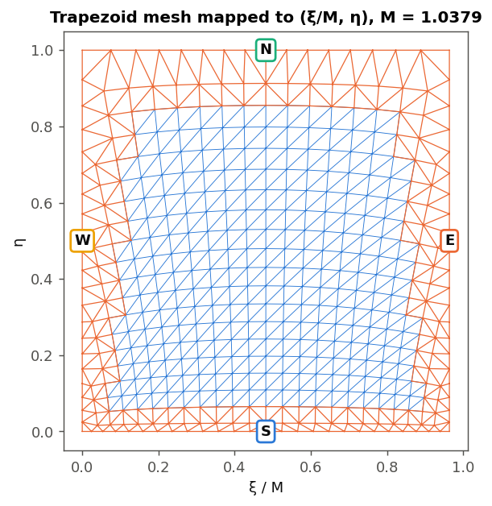

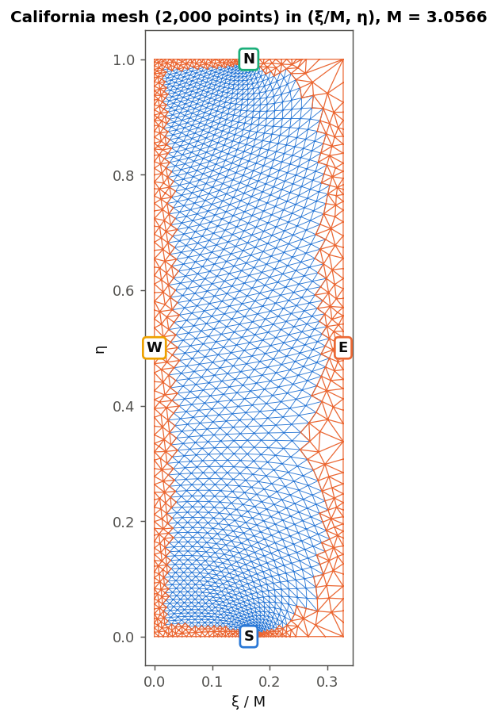

Scaling $\xi$ by $1/M$ makes the image the true conformal rectangle. Small triangles keep their
shape and are only scaled and rotated; that is conformality, visible directly. The band is
squeezed in the middle of the S side. That is the convex south-east bulge round vertex 1: the
field is weak there, so a physical region maps to a small image, and the grid cells there are
large (compare the cell-size map in §11).

## 10. `solve`: fallback, snapping, corners, unprojection

[L509–571](../../../regional_mom_workflows/mom6_forge-worktrees/conformal-solver/mom6_forge/_conformal.py#L509).

1. **Mesh and fields:** `_solve_mesh`
   ([L543](../../../regional_mom_workflows/mom6_forge-worktrees/conformal-solver/mom6_forge/_conformal.py#L543)).
2. **Sample** the $(2n_y+1)\times(2n_x+1)$ supergrid with step $0.5/(n_x, n_y)$
   ([L548–550](../../../regional_mom_workflows/mom6_forge-worktrees/conformal-solver/mom6_forge/_conformal.py#L548)).
   Supergrid points include cell centres and edge midpoints, as MOM6's `ocean_hgrid` needs.
3. **Nearest-node fallback**
   ([L551–555](../../../regional_mom_workflows/mom6_forge-worktrees/conformal-solver/mom6_forge/_conformal.py#L551)).
   A point that landed in no image triangle takes the physical position of the mesh node nearest
   to it *in $(\xi,\eta)$*, found with a KD-tree over the finite nodes. When can it trigger? Each
   side's nodes carry that side's Dirichlet value, and the other field runs 0→1 along it, so the
   mesh boundary maps onto the boundary of the unit square. A continuous map of a disc whose
   boundary goes once round the square covers every point of the square. So misses need a mesh
   with a hole whose rim isn't on a Dirichlet side, or roundoff beyond the 1e-9 tolerance.
   Measured: **0 misses** in every case I ran (§15.8).
4. **Snap the outer rows and columns onto the sides**
   ([L556–563](../../../regional_mom_workflows/mom6_forge-worktrees/conformal-solver/mom6_forge/_conformal.py#L556)).
   - For side $k$, take the free field along it (ξ on S and N, η on E and W) at the side's nodes,
     as a function of arclength `s`.
   - Find where it equals the uniform targets `along` with `np.interp` (inverse interpolation).
   - Place the node at that arclength on the side polyline, with a second `np.interp`.
   - N and W run backwards (side $k$ goes corner $k$ → $k+1$ counter-clockwise), so they use
     $1-u$ against $1-a$. That makes $u$ increasing and puts the result in the grid's W→E or S→N
     order.

   `np.maximum.accumulate(clip(u, 0, 1))` makes `xp` monotone, as `np.interp` requires; it
   flattens any dip. In the normal case snapping changes nothing. Along a mesh edge the 2D
   barycentric sample is linear in $\xi$, which is exactly what the 1D interp computes. On
   California the snapped rows moved by at most $2\times10^{-10}$ m, and $u$ was monotone on all
   four sides. Snapping is there for robustness: it guarantees the outer nodes are on the outline
   (the test checks to 1 mm) whatever happened in `_sample`.
5. **Pin the corners**
   ([L565](../../../regional_mom_workflows/mom6_forge-worktrees/conformal-solver/mom6_forge/_conformal.py#L565)):
   the four supergrid corners are set to the outline's corner points exactly.
6. **Unproject** to lon/lat
   ([L567](../../../regional_mom_workflows/mom6_forge-worktrees/conformal-solver/mom6_forge/_conformal.py#L567)).
7. **Clip latitudes** off the poles
   ([L569](../../../regional_mom_workflows/mom6_forge-worktrees/conformal-solver/mom6_forge/_conformal.py#L569)).

**`ConformalGrid`** ([L267–309](../../../regional_mom_workflows/mom6_forge-worktrees/conformal-solver/mom6_forge/_conformal.py#L267))
is what `solve` returns. It holds:
- the supergrid `lon, lat` (degrees) and `x, y` (projection metres);
- `nx, ny`, `projection`, `aspect` ($= n_y/n_x$ target);
- `h`, `corners`, `corner_angles`;
- `qlon, qlat`, the cell corners (`[::2, ::2]`).

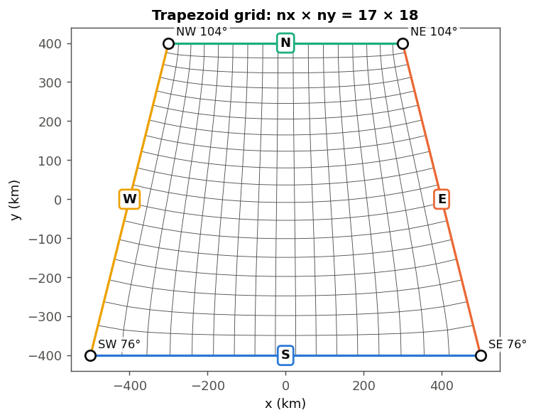

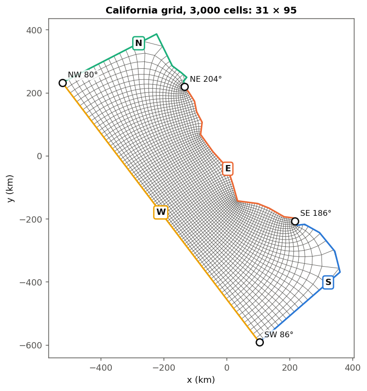

## 11. Cell geometry and the projection score: `_cell_geometry`, `size_ratios`

**`_cell_geometry(cg)`** ([L574–586](../../../regional_mom_workflows/mom6_forge-worktrees/conformal-solver/mom6_forge/_conformal.py#L574))
returns true cell sizes on the Earth:
- `get_factors` gives the projection's scale factor $k$ at each cell corner. It uses
  `meridional_scale`; for a conformal projection that equals the parallel scale.
- $k$ is averaged to edge midpoints, and each projected edge length is divided by it to get the
  true length.
- The S and N edges are averaged to give $dx$, and W and E to give $dy$.
- It returns the corners, the size $\sqrt{dx\,dy}$ in km and the aspect $\max(dx/dy, dy/dx)$,
  memoised on `cg._geometry`.

These are metric lengths on the ellipsoid to first order in the cell size, independent of
mom6_forge's haversine metrics.

**`size_ratios(lon, lat, corners)`** ([L589–618](../../../regional_mom_workflows/mom6_forge-worktrees/conformal-solver/mom6_forge/_conformal.py#L589)):
- does a coarse `solve` with 256 cells on a 1,000-point mesh in each projection kind;
- returns {kind: 99th / 1st percentile of cell size};
- skips any kind whose solve raises.

It takes 35 ms on California. `Grid.from_outline` picks the smallest. The percentiles are there
to discount corner cells, but at 256 cells the 1st percentile is about the 3rd-smallest cell,
which is still a corner cell. So the ratio keeps growing with resolution (lcc: 4.82 at 1k,
6.13 at 250k, 6.64 at 250k with 12k cells). The ranking between kinds isn't stable either:
merc is lowest at most settings, but tmerc is lowest at 20k points with 12k cells. See §15.4.

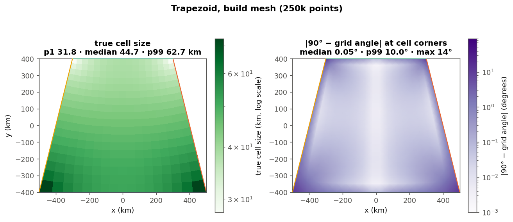

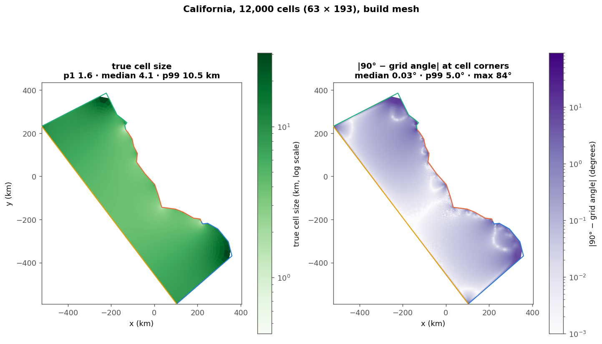

The orthogonality maps are the deviation from 90° between grid lines at each cell corner (as in
the tests' `_ortho`). Away from the outline it is around 0.01–0.1°. It rises near reflex
vertices and peaks at the corner nodes, where an 86° or 204° outline corner can't be 90°.
California: median 0.03°, p99 5.0° over all nodes; p99 2.26° and max 34.1° once the 2 node rings
nearest the outline are skipped.

## 12. Resolution helpers: `outline_area_km2`, `n_cells_for_resolution`, `nominal_resolution_km`

- **`outline_area_km2`** ([L312](../../../regional_mom_workflows/mom6_forge-worktrees/conformal-solver/mom6_forge/_conformal.py#L312)):
  geodesic polygon area on WGS84 (`Geod.polygon_area_perimeter`). Note that this treats edges as
  geodesics, while the solve treats them as straight lines in the projection plane (§1).
- **`n_cells_for_resolution`** ([L318–334](../../../regional_mom_workflows/mom6_forge-worktrees/conformal-solver/mom6_forge/_conformal.py#L318)):
  $N = \text{area}/\text{res}^2$, rounded, at least 1, with the resolution floored at 1e-9 so a
  0 can't divide.
- **`nominal_resolution_km`** ([L337–344](../../../regional_mom_workflows/mom6_forge-worktrees/conformal-solver/mom6_forge/_conformal.py#L337)):
  walks the grid's outer ring of cell corners (S row W→E, E column up, N row back, W column
  down), takes its geodesic area, and returns $\sqrt{\text{area}/(n_xn_y)}$. It duck-types on
  `qlon, qlat, nx, ny`, so a `Grid` works too; `tests/test_grid.py` relies on that.

"Resolution" is therefore the edge of a square cell with the *mean* cell area. Cell size varies
around it: on California p1, median and p99 are 1.6, 4.1 and 10.5 km at a nominal 4.9 km.

## 13. The public API: `Grid.from_outline`, `_from_conformal`, `from_lonlat_arrays`

**`Grid.from_outline`** ([grid.py L645–706](../../../regional_mom_workflows/mom6_forge-worktrees/conformal-solver/mom6_forge/grid.py#L645)):
1. Corners default to `[0, 1, 2, 3]`, but only for a 4-vertex outline
   ([L689–696](../../../regional_mom_workflows/mom6_forge-worktrees/conformal-solver/mom6_forge/grid.py#L689)).
2. `resolution_km` and `n_cells` are mutually exclusive. The default is 10,000 cells.
3. **`projection="auto"` or `None` → `size_ratios`, smallest wins**
   ([L697–700](../../../regional_mom_workflows/mom6_forge-worktrees/conformal-solver/mom6_forge/grid.py#L697)).
   If every kind failed, it passes `"auto"` on, so the real solve raises the real error.
4. `cf.solve` at the default 250k mesh, then `_from_conformal`.

**`_from_conformal`** ([L709–723](../../../regional_mom_workflows/mom6_forge-worktrees/conformal-solver/mom6_forge/grid.py#L709)):
- builds the `Grid` from the supergrid lon/lat with `grid_type="conformal_orthogonal"`;
- sets `grid.outline` = {lon, lat, corners **as given**, `asdict(projection)`, resolution_km},
  all plain floats and ints so it serialises to JSON. `resolution_km` is the requested value,
  or the nominal one when `n_cells` was given.

The class attribute `outline = None` is at L109–110. In #151 it lives in memory only; writing it
to the supergrid file is planned for a later chunk (ROADMAP PR 5).

**`from_lonlat_arrays`** ([L618–642](../../../regional_mom_workflows/mom6_forge-worktrees/conformal-solver/mom6_forge/grid.py#L618))
calls `SupergridBase._init_from_xy(lon, lat, grid_type, dx_dy_calc_type="haversine")`. So **all
MOM6 metrics are recomputed on the sphere from the node positions**, as for any other mom6_forge
grid:
- `dx`, `dy` by haversine between neighbouring supergrid nodes;
- areas from `quadrilateral_areas`;
- `angle_dx` by the expanded-supergrid method.

Nothing from the projection is carried over, and this is also where the dateline seam is repaired
(§2). Haversine is the right choice: #145, the base of this branch, makes the smallangle formula
fall back to haversine for any non-rectilinear lon/lat grid.

## 14. What PR #149 adds to the math

#149's `_conformal.py` (`git show 55e7010b:mom6_forge/_conformal.py`, or
[on GitHub](https://github.com/amrhein/mom6_forge/blob/55e7010b43d4b7afdd14c608600fa8b8c070be4e/mom6_forge/_conformal.py#L377))
adds corner refinement, a preview solve and land helpers.

**The corner singularity.** Near a boundary vertex of interior angle $\alpha$, a harmonic field
behaves like $u \sim r^{\lambda}$ with $\lambda = \alpha_0/\alpha$. Here $\alpha_0$ is the angle
at which the vertex is smooth:
- $\alpha_0 = 180°$ where both edges carry the same kind of condition. That is any vertex along a
  side: both Dirichlet for one field, both zero-flux for the other.
- $\alpha_0 = 90°$ at a grid corner, where one edge is Dirichlet and the other zero-flux for the
  same field (the mixed case).

So $|\nabla u| \sim r^{\lambda-1}$, which blows up at a reflex side vertex ($\alpha > 180°$) and
at an obtuse corner ($\alpha > 90°$). For P1 on a uniform mesh, the energy error near such a
point is $O(h^{2\lambda})$ instead of $O(h^2)$, and the gradients nearby (hence the grid angles)
are poor. California's worst offenders:

| vertex | role | angle | smooth angle | $\lambda$ |
|---|---|---|---|---|
| 22 | NE corner | 203.5° | 90° | 0.44 |
| 6 | SE corner | 185.7° | 90° | 0.48 |
| 5 | side vertex | 249.4° | 180° | 0.72 |
| 11 | side vertex | 247.0° | 180° | 0.73 |
| 24, 15, 27, 8 | side vertices | 231°, 223°, 207°, 203° | 180° | 0.78–0.89 |

**`_spots(P, corners, count)`** ([#149 L377–384](https://github.com/amrhein/mom6_forge/blob/55e7010b43d4b7afdd14c608600fa8b8c070be4e/mom6_forge/_conformal.py#L377))
ranks vertices by angle / smooth angle and keeps up to `count` with a ratio above 10/9. That
means corners above 100° and side vertices above 200°. `count = raster_points // 4000` (#149
L500): 0 below 4,000 points, 5 at the 20k preview, 62 at the 250k build. 62 is only a cap:
California has **8** vertices past the threshold, so the build refines 8 spots.
(The ROADMAP's "Build does too (62 spots)" means the cap.)

**`_levels(xy, spots, h)`** ([#149 L387–391](https://github.com/amrhein/mom6_forge/blob/55e7010b43d4b7afdd14c608600fa8b8c070be4e/mom6_forge/_conformal.py#L387))
gives each point a level $l$ from its distance $d$ to the nearest spot (in units of $h$). The
thresholds are `6/2**[4,3,2,1,0]` = [0.375, 0.75, 1.5, 3, 6]:

| $d$ (units of $h$) | $\ge 6$ | 3–6 | 1.5–3 | 0.75–1.5 | 0.375–0.75 | < 0.375 |
|---|---|---|---|---|---|---|
| level $l$ | 0 | 1 | 2 | 3 | 4 | 5 |
| spacing | $h$ | $h/2$ | $h/4$ | $h/8$ | $h/16$ | $h/32$ |

Each level's spacing is proportional to its distance from the spot: **geometric grading**. Every
ring holds about the same number of nodes (the radius and the spacing both halve). Each spot
costs about 1,000–1,500 extra nodes, independent of $h$; measured, California gains 8,478 nodes
at 250k and 5,158 at 20k.

**How the fine nodes get into the mesh:**
- `_sides` subdivides 32× finer and keeps every `32 >> level`-th point
  ([#149 L403–408](https://github.com/amrhein/mom6_forge/blob/55e7010b43d4b7afdd14c608600fa8b8c070be4e/mom6_forge/_conformal.py#L403)),
  so boundary spacing follows the same grading.
- `_mesh` fills a disc of 12 steps' radius at each level, keeping points inside the polygon,
  at that level, and more than half a step from the outline
  ([#149 L428–436](https://github.com/amrhein/mom6_forge/blob/55e7010b43d4b7afdd14c608600fa8b8c070be4e/mom6_forge/_conformal.py#L428)).
- Squares stay out of the discs (`ds > 8`, L438), and lattice nodes within $10h$ of a spot join
  the Delaunay band (L445).

The rest of the pipeline is unchanged.

What refinement buys, measured on California (#151 vs #149's `55e7010b`; orthogonality skips the
node rings within about $2h$ of the outline, as the tests do):

| mesh | solver | nodes | $E_\xi E_\eta - 1$ | ortho p99 / max | folds |
|---|---|---|---|---|---|
| 20k | #151 (uniform) | 20,383 | 5.6e-3 | 5.48° / 45.7° | 0 |
| 20k | #149 (5 spots) | 25,541 | 4.9e-4 | 0.56° / 4.0° | 0 |
| 250k | #151 (uniform) | 251,287 | 1.7e-3 | 2.26° / 34.1° | 0 |
| 250k | #149 (8 spots) | 259,765 | 1.4e-4 | 0.46° / 3.0° | 0 |

These match the ROADMAP table. Refinement fixes the *computed* map's accuracy near those
vertices. It doesn't change the small corner cells, which belong to the exact map
([01 §1.8](01_the_problem.md)).

**`solve_fields`** ([#149 L544–584](https://github.com/amrhein/mom6_forge/blob/55e7010b43d4b7afdd14c608600fa8b8c070be4e/mom6_forge/_conformal.py#L544))
is `solve` without the inversion:
- runs `_solve_mesh`;
- samples $\xi, \eta$ on a regular physical raster (spacing $h$), with the same `_sample` used
  in the forward direction;
- returns the raster, an `inside` mask, nx, ny and aspect.

It is the GridSketcher's live preview: contours of $\xi$ and $\eta$ are the grid lines, drawn
without building the grid, at `PREVIEW_RASTER_POINTS = 20_000`. The land helpers
(`_land_geometry`, `land_window`, `land_polygons`) clip Natural Earth land polygons for the
widget's map and are not part of the math.

## 15. Things a reviewer should look at

These are observations, not verdicts. Each was checked by running the code on `db0db39` (or
`55e7010b` where noted). The probe scripts are not part of the repo.

1. **Stale section header.** `# --- land ---`
   ([tests/test_conformal.py L286](../../../regional_mom_workflows/mom6_forge-worktrees/conformal-solver/tests/test_conformal.py#L286))
   heads only the California benchmark. The three `land_*` tests were cut from #151.
2. **Stale docstring.** `ConformalGrid.h` says "Mesh spacing of the solve (finer round singular
   vertices)"
   ([L281–282](../../../regional_mom_workflows/mom6_forge-worktrees/conformal-solver/mom6_forge/_conformal.py#L281)).
   In #151, `_sides` and `_mesh` use one uniform $h$; refinement comes back in PR 2b.
3. **Bare `except Exception` in `size_ratios`**
   ([L614](../../../regional_mom_workflows/mom6_forge-worktrees/conformal-solver/mom6_forge/_conformal.py#L614)).
   The expected failure is a `ValueError` (Lambert on the equator, a pole outline in a
   non-stereographic plane). A real bug in one kind's path would silently drop that kind, and
   "auto" would quietly choose among the rest. Narrowing to `ValueError` (plus qhull's error, if
   wanted) would surface it.
4. **Two different "auto" choices.**
   - `cf.solve(projection=None)` uses `projection_for("auto")`, a latitude rule
     ([L174–175](../../../regional_mom_workflows/mom6_forge-worktrees/conformal-solver/mom6_forge/_conformal.py#L174)).
   - `Grid.from_outline(projection="auto")` (also its default) uses the smallest `size_ratios`
     ([grid.py L697–700](../../../regional_mom_workflows/mom6_forge-worktrees/conformal-solver/mom6_forge/grid.py#L697)).

   The docstring at L138–139 acknowledges this. On California they disagree: lcc for `solve`
   (63 × 193) and merc for `from_outline` (63 × 188), so the same outline gives different grids
   depending on the entry point. Given §1, both choices mainly decide which curves the long edges
   are, and `size_ratios` decides it on a 256-cell, 1,000-point solve whose ratios differ by about
   4% (4.82 / 4.61 / 4.82 / 4.81) and whose ranking changes with resolution (§11). A simpler
   option, also raised in [01 §1.7](01_the_problem.md): densify the outline along geodesics before
   projecting. The grid then stops depending on the projection, and one chooser is enough.
5. **"Cells are orthogonal by construction."** This is in #149's first commit message (`d357c62`);
   #151's message doesn't repeat it. It holds for the exact map; the computed grid is orthogonal
   only to discretisation accuracy.
   - #151 at 250k on California: p99 2.26°, max 34.1° away from the outline.
   - At the corner nodes themselves: up to 84°. That is inherent, since a 186° outline corner
     can't become 90°.
   - With #149's refinement: p99 0.46°, max 3.0°.

   Worth rewording when the chunk is reopened.
6. **Simplicity is checked in lon/lat, but the mesh uses straight edges in the projection plane**
   ([L362](../../../regional_mom_workflows/mom6_forge-worktrees/conformal-solver/mom6_forge/_conformal.py#L362)).
   These are different polygons. Example:
   - a box from 60–70°N, 40°W–40°E, with a 2°-wide notch cut from the north side down to 61°N
     (vertices `lon=[-40,40,40,1,1,-1,-1,-40]`, `lat=[60,60,70,70,61,61,70,70]`, corners
     `[0,1,2,7]`);
   - it is simple in lon/lat;
   - in LCC, tmerc and stere the straight 60°N edge bows poleward across the notch, so the
     polygon self-intersects in the plane;
   - `cf.solve` **doesn't raise**. It returns grids with 773 (lcc), 702 (tmerc) and 717 (stere)
     folded cells out of about 2,000.

   `projection_for("auto")` picks stere for this outline. `from_outline` happens to pick merc
   (simple in the plane, 0 folds), because the folded kinds score `inf` in `size_ratios`. The
   example is contrived, but a long edge at high latitude can do this. Checking `is_simple(x, y)`
   after projecting, in `_solve_mesh`, would catch it; that also covers a user-supplied
   `MapProjection`.
7. **The Delaunay band is not a constrained triangulation, so it can bridge thin land.**
   Triangles are kept when their *centroid* is inside the outline (§5).
   - **Straight slits never bridged.** A straight, axis-aligned slit of land into a 100 km box,
     width/h from 0.06 to 5.7 at three mesh sizes: never. A triangle spanning two parallel walls
     has two vertices on one wall, so its centroid sits a third of the way across the slit,
     outside the polygon.
   - **Bent spits did bridge.** A **0.2 km-wide bent spit** (zig-zag or hook), on a mesh with
     $h$ = 1.6–3.2 km, did at every rotation tried (0°, 17°, 30°, 45°).
     - For the zig-zag at $h$ = 3.2 km: 70 kept triangles cross the spit and the aspect is
       0.817, against 0.677 on the build mesh (+21%).
     - $\xi$ is non-monotone along the S side (24 decreasing steps), so `np.maximum.accumulate`
       is doing real work.
     - 80 image triangles flip, so "last write wins" decides some points.
     - The grid folds: 2 cells at 2,500 cells, 10 at 10,000.
     - At $h$ = 0.71 km (a 20k mesh) it still bridges (198 triangles, aspect 0.820). On the
       250k build mesh ($h$ = 0.2 km), 2 triangles at the tip remain and the aspect converges.
   - **California is unaffected.** At `size_ratios`' 1,000-point mesh ($h \approx 17$ km), no
     kept triangle extends outside the outline at all.

   So in practice: features narrower than about $h/3$ that bend can be bridged. At the build
   mesh that means sub-km spits or barrier islands in a California-sized domain. At the 1k
   `size_ratios` mesh it means any bent feature narrower than a few km, though there it would
   only skew the projection pick. Possible remedies, untested: space boundary nodes by the local
   feature size where the outline comes within ~$h$ of itself, so the unconstrained Delaunay
   recovers the outline; or a constrained triangulation (a new dependency).

   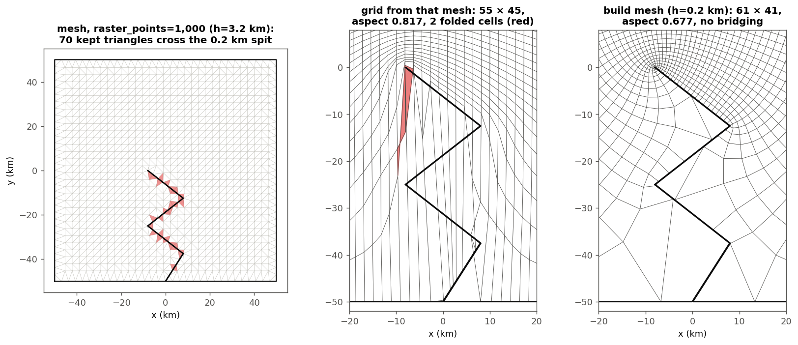
8. **`_sample`'s orientation-blindness and the nearest-node fallback never mattered on any
   normal outline.** For each case I counted:
   - image triangles whose orientation flips;
   - lattice points strictly inside more than one image triangle;
   - lattice points in no image triangle.

   All three are **zero** for:
   - California at 1k, 20k and 250k in both lcc and merc;
   - the trapezoid;
   - the `tests/test_conformal.py` outlines I ran: the 7 edge-case boxes, the duplicate-vertex
     and near-flat outlines, the 75°N pole square and the dateline outline.

   Overlaps appear only on bridged meshes (item 7): up to 1,871 multiply-covered points at
   100,000 cells. The **fallback never fired** in any case, bridged ones included, and neither
   did it on outlines with interior narrow channels that left small holes in the mesh (their rims
   lie on a Dirichlet side, so the image just collapses onto the square's edge). So both mechanisms
   are untested safety nets. Where overlap does happen, `_sample` resolves it silently. Counting
   flipped image triangles (one cross product per triangle) would make a cheap warning: zero on
   good meshes, non-zero exactly when the computed map folds.
9. **Minor: `corner_angles` at a duplicated corner vertex.**
   `test_duplicate_vertex_and_near_flat_corner_still_solve` puts a corner on a repeated vertex.
   Its reported angle is **0.0°**: the zero-length edge gives `atan2(+0, −0) = 180°` of turning.
   Harmless in #151, where `corner_angles` is only reported. #149's `_spots` reads the same
   angles; it can't select such a vertex, but any warning built on `corner_angles` later should
   skip zero-length edges, as `_sides` does.

## 16. What I could not verify

- **That the band always conforms to the squares.** §5 argues the full-square region is fenced by
  Delaunay edges for every outline. I checked conformity numerically (triangle areas summing to
  the polygon area, every edge used once or twice) on California and all test outlines, not as a
  proof for every outline.
- **The bridging thresholds** (bent features narrower than about $h/3$) are empirical, from 2 spit
  shapes × 4 rotations × 3–4 mesh sizes. They are not a rule.
- **The convergence rates** ($O(h^{2\lambda})$ energy error, the $h^{0.88}$ prediction) are
  textbook P1 theory. I compared them only to the measured slope, $h^{0.96}$.
- **No test suite was run** (pytest was out of scope), and gridgen wasn't run for comparison.
- **#149 was only read and run as a module from `git show`.** The widget code that calls
  `solve_fields` wasn't exercised.
