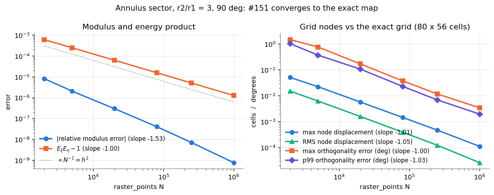
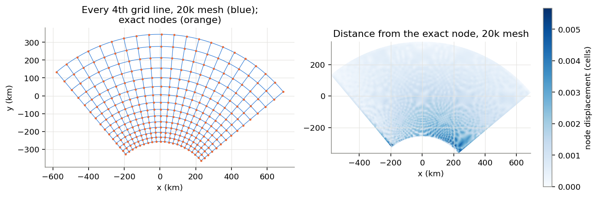
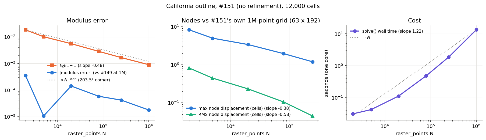
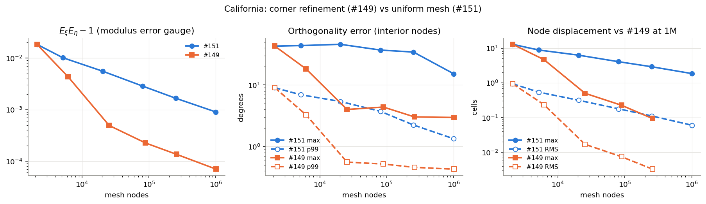
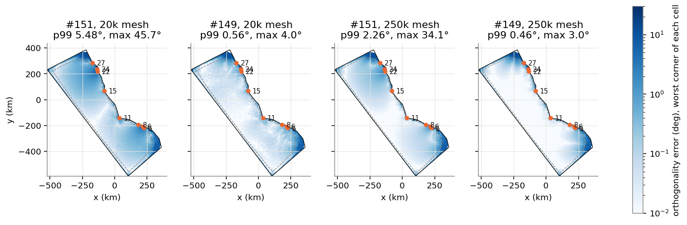
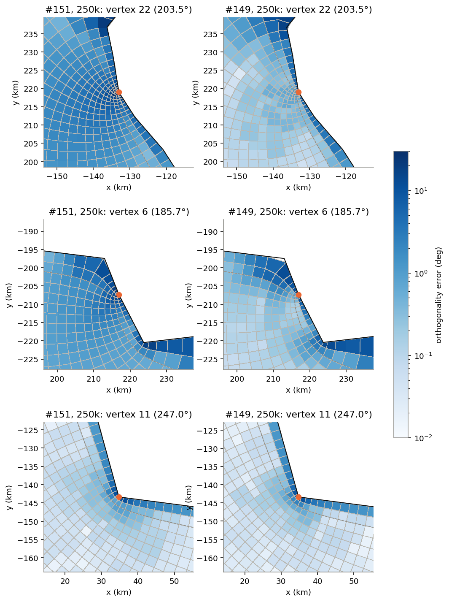
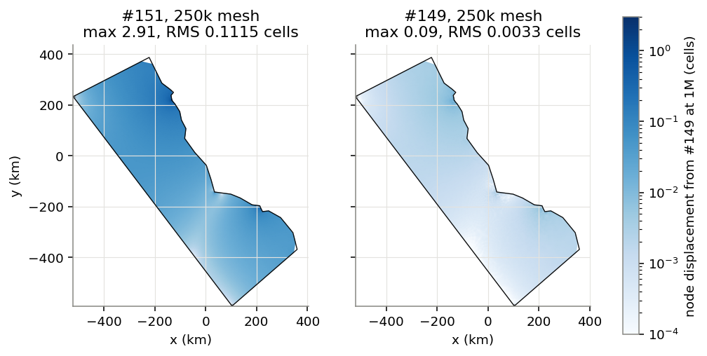
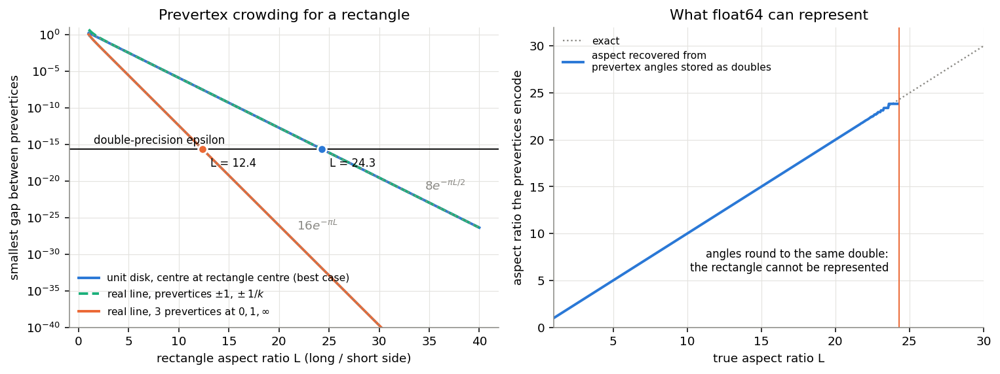

# 4. Experiments: testing Dan's solver against exact answers

**Summary of results**

- **Annulus sector (exact answer):** #151 converges to the exact grid at the optimal P1 rate,
  $h^2$, in energy, nodes and angles. The modulus converges like $h^3$. At 250k points the
  modulus is off by $7\times10^{-9}$, nodes by $5\times10^{-4}$ cell, angles by 0.01°.
  `aspect` $=n_y/n_x=\ln(r_2/r_1)/\Delta\theta$. The rectangle is exact to rounding.
- **California:** the 203.5° NE grid corner slows convergence to $N^{-0.44}$. At 250k points
  the modulus is off by $4\times10^{-5}$ (enough to flip $n_y$: 193 vs the converged 192),
  and nodes are off by 0.11 cell RMS and 2.9 cells at the NE corner. Solve 1.9 s; cost also
  grows linearly with the number of outline vertices.
- **Refinement:** the ROADMAP table reproduces (0 folds). Refinement also cuts the RMS node
  error 34× for 3% more nodes. The refined 0.46°/3.0° is the orthogonality measure's own
  floor at 63 × 192, not solver error.
- **Crowding:** $e^{-\pi L}$ is right for the prevertex cross-ratio ($16e^{-\pi L}$). The best
  achievable gap is $8e^{-\pi L/2}$, which hits double-precision epsilon at $L\approx24$.
  #151 solves 50:1 channels to $10^{-9}$.

**Reproduce:** `experiments.ipynb` in this folder (dev_mf env, worktree `conformal-solver`
at `db0db39`, #149 read from `55e7010b` with `git show` into a temporary file). It saves
every figure below to `figures/exp_*.png`. It runs in about 4 minutes on one core; the
1M-point solves dominate. Times quoted are wall time of `solve()` on one core of a shared
login node (crlogin2), so treat them as ±20%.

---

## 4.0 What is measured

| quantity | definition |
|---|---|
| raster_points $N$ | the `raster_points` argument; mesh spacing $h=\sqrt{\text{area}/N}$ |
| modulus error | `aspect` $/M - 1$, against the exact (or best available) modulus $M$ |
| $E_\xi E_\eta - 1$ | product of the two Dirichlet energies, recomputed from the captured mesh and fields. It is exactly 1 in the continuum. |
| node displacement | $\lvert$node − reference node$\rvert$ divided by the local cell size $\sqrt{\lvert\partial_i\mathbf{x}\rvert\,\lvert\partial_j\mathbf{x}\rvert}$ of the reference grid, over all $(n_y+1)(n_x+1)$ cell-corner nodes. Reported as max and RMS. |
| orthogonality error | deviation from 90° of the angle between the two centred-difference grid directions at each cell-corner node. The node rings within about $2h$ of the outline are skipped. This is `_ortho` in `tests/test_conformal.py`, the same as #149's `grid_quality`. Reported as p50, p99 and max. |
| folds | supergrid quads with non-positive signed area |

To compare grids node by node, the cell counts are **pinned**: the notebook wraps the
solver's `_solve_mesh` (in memory, not in the file) and overrides `nx, ny` with a fixed pair.
The pair the solver would have picked is reported alongside. Otherwise the code path is
exactly `cf.solve`.

**A free, guaranteed error bar.** The finite-element energy of each field is at least the
true energy (Dirichlet's principle; [01 §1.5](01_the_problem.md)). Write
$E_{\xi,h}=M(1+a)$ and $E_{\eta,h}=(1+b)/M$ with $a,b\ge0$. Then

$$
\left|\ln\frac{\text{aspect}_h}{M}\right| = \tfrac12\,\lvert\ln(1+a)-\ln(1+b)\rvert \;\le\; \tfrac12\ln\!\left(E_{\xi,h}E_{\eta,h}\right).
$$

So half of $E_\xi E_\eta - 1$ bounds the relative modulus error, for the region as meshed.
The bound held on every mesh in experiments 1 and 2. It is usually pessimistic by 1 to 3
orders of magnitude, because the two energy errors partly cancel in the ratio.

---

## 4.1 Exact answer: the annulus sector

**Setup.** The region $r_1<r<r_2$, $\theta_E<\theta<\theta_W$ around a centre $c$ in a fixed
Lambert conformal plane (`MapProjection("lcc", -100, 35, 33, 37)`, as in the test fixture).
The values are $r_1=300$ km, $r_2=900$ km, $\theta_W=130°$ and $\theta_E=40°$, with
$c=(0,-556)$ km. The sector is tilted 5° off symmetric: at exactly 135°/45° the solver's "SW
= smallest $x+y$" rule ties between the inner and outer west vertices. Each arc is cut into
1024 chords, with a sagitta under 0.3 m. The outline is unprojected with `to_lonlat`, and the
projection is passed explicitly.

$w=\log(z-c)=\ln r + i\theta$ maps the region onto a rectangle, so the exact fields are

$$
\xi=\frac{\theta_W-\theta}{\Delta\theta}\ \ (\text{W radial side}\to\text{E}),\qquad
\eta=\frac{\ln(r/r_1)}{\ln(r_2/r_1)}\ \ (\text{inner arc = S}\to\text{outer arc = N}).
$$

They meet Dan's boundary conditions: $\partial\xi/\partial r=0$ on the arcs and
$\partial\eta/\partial\theta=0$ on the radial sides. The exact energies are
$E_\xi=\int(r\Delta\theta)^{-2}\,r\,dr\,d\theta=\ln(r_2/r_1)/\Delta\theta$ and
$E_\eta=\Delta\theta/\ln(r_2/r_1)$. So in Dan's orientation

$$
M=\frac{n_y}{n_x}=\sqrt{E_\xi/E_\eta}=\frac{\ln(r_2/r_1)}{\Delta\theta}=\frac{\ln 3}{\pi/2}=0.699398 .
$$

The solver returns 0.699398, not the reciprocal 1.4298. The exact grid is radial lines at
uniform angle, crossed by circles at geometrically spaced radii $r_1(r_2/r_1)^{j/n_y}$. It is
exactly orthogonal under the centred-difference measure (interior nodes: $5\times10^{-13}$°).
Cell counts are pinned at $80\times56$, which is also the solver's own choice on every mesh.
Cells are about 5.9 km on the inner arc and 17.7 km on the outer.

| $N$ | mesh nodes | $h$ (km) | modulus error | $E_\xi/M-1$ | $E_\eta M-1$ | $E_\xi E_\eta-1$ | max disp. (cells) | RMS disp. | ortho p50 / p99 / max (°) | time (s) |
|---|---|---|---|---|---|---|---|---|---|---|
| 2k | 4,027 | 16.8 | 8.2e-6 | 3.2e-4 | 3.0e-4 | 6.2e-4 | 5.1e-2 | 1.5e-2 | 0.088 / 1.03 / 1.48 | 0.08 |
| 5k | 7,024 | 10.6 | 2.1e-6 | 1.3e-4 | 1.2e-4 | 2.5e-4 | 2.2e-2 | 6.2e-3 | 0.039 / 0.37 / 0.76 | 0.14 |
| 20k | 21,981 | 5.3 | 3.0e-7 | 3.2e-5 | 3.1e-5 | 6.3e-5 | 5.7e-3 | 1.6e-3 | 0.0089 / 0.11 / 0.17 | 0.5 |
| 80k | 81,896 | 2.7 | 4.1e-8 | 8.0e-6 | 7.9e-6 | 1.6e-5 | 1.4e-3 | 3.9e-4 | 0.0022 / 0.023 / 0.037 | 2.0 |
| 250k | 251,822 | 1.5 | 7.0e-9 | 2.5e-6 | 2.5e-6 | 5.1e-6 | 4.6e-4 | 1.2e-4 | 0.0007 / 0.0068 / 0.012 | 6.8 |
| 1M | 1,002,631 | 0.75 | 7.6e-10 | 6.4e-7 | 6.3e-7 | 1.3e-6 | 1.1e-4 | 2.6e-5 | 0.0002 / 0.0019 / 0.0034 | 35 |

(The 2,050 outline vertices add about 2,000 boundary nodes, which is why the 2k mesh has
4k nodes. Why the times are 3.5× California's is in 4.2.)

**Observations**

- **$h^2$ everywhere it should be.** $E_\xi E_\eta-1$, max and RMS node displacement and the
  orthogonality error all have log-log slope −1.00 to −1.05 against $N$, which is $h^2$. That
  is the optimal rate for P1 elements on a smooth solution. Here all four corners are 90° and
  the sides are arcs, so the fields are smooth up to the boundary.
- **The modulus converges faster, about like $h^3$ (slope −1.53).** Both energies are too
  high by almost the same fraction ($2.54\times10^{-6}$ vs $2.53\times10^{-6}$ at 250k), and
  $\sqrt{E_\xi/E_\eta}$ cancels the common part. This is the payoff for solving for both ξ and
  η instead of one: the product measures the error, and the ratio cancels most of it.
- **The arcs' polygonization is not what limits accuracy.** Four times as many chords (16×
  smaller sagitta) changes the 250k modulus error from $7.03\times10^{-9}$ to
  $7.11\times10^{-9}$, and leaves $E_\xi E_\eta-1$ unchanged.
- **The error sits near the two inner corners** (right panel), where $|\nabla\xi|$ is
  largest, $1/(r_1\Delta\theta)$, and the mesh is coarsest relative to the cells. The ripple
  pattern is interference between the square mesh lattice and the curved grid.
- **The rectangle is exact.** The 1000 × 600 km rectangle at 2k, 20k and 250k points gives
  `aspect` − 0.6 ≈ $10^{-14}$ and $E_\xi E_\eta-1\approx10^{-13}$. Nodes land within
  $2\times10^{-6}$ m and angles within $3\times10^{-11}$°. Linear fields are represented
  exactly by linear elements, so only rounding is left.

**What this tells a reviewer.** There is no hidden bias in the method. The boundary
conditions, the energy-to-aspect formula, the orientation (ξ W→E, `aspect` = $n_y/n_x$), the
inversion to a uniform $(\xi,\eta)$ supergrid and the placement of the outer rows on the
sides all converge to the exact conformal grid at the optimal rate. On a smooth region a 20k
preview is already within 0.006 cells and 0.2° of exact. Every larger error in the
experiments below comes from **singular vertices**, not from the algorithm.

---

## 4.2 California: convergence and cost

**Setup.** `tests/data/california_bays.outline.json` (30 vertices, corners `[0, 6, 22, 29]`),
12,000 cells, the auto LCC plane (`lon_0` −120.78, standard parallels 31.97/37.83). Cells are
pinned at 63 × 192, the 1M mesh's choice. Node displacement is measured against #151's own
1M grid, as asked. There is no exact modulus, so the best estimate is
$M^\ast=3.055468$: #149's refined solver at 1M points, which is stationary (3.055467 →
3.055467 → 3.055468 from 80k to 1M; see 4.3).

| $N$ | nodes | solver's $n_x\times n_y$ | $63\times$aspect | modulus err. vs $M^\ast$ | bound $\tfrac12\ln E_\xi E_\eta$ | $E_\xi E_\eta-1$ | max disp. vs 1M (cells) | RMS disp. | ortho p50 / p99 / max (°) | time (s) |
|---|---|---|---|---|---|---|---|---|---|---|
| 2k | 2,128 | 63 × 193 | 192.56 | +3.6e-4 | 9.2e-3 | 1.85e-2 | 8.27 | 0.82 | 0.49 / 9.0 / 42.8 | 0.03 |
| 5k | 5,194 | 63 × 192 | 192.49 | −1.1e-5 | 5.1e-3 | 1.02e-2 | 4.98 | 0.44 | 0.25 / 6.9 / 43.6 | 0.04 |
| 20k | 20,383 | 63 × 193 | 192.52 | +1.4e-4 | 2.8e-3 | 5.58e-3 | 3.40 | 0.23 | 0.12 / 5.4 / 45.7 | 0.11 |
| 80k | 80,746 | 63 × 193 | 192.51 | +5.8e-5 | 1.4e-3 | 2.86e-3 | 1.96 | 0.11 | 0.057 / 3.7 / 36.9 | 0.5 |
| 250k | 251,287 | 63 × 193 | 192.50 | +4.2e-5 | 8.3e-4 | 1.67e-3 | 1.20 | 0.045 | 0.031 / 2.2 / 34.2 | 1.9 |
| 1M | 1,002,578 | 63 × 192 | 192.50 | +1.8e-5 | 4.5e-4 | 9.0e-4 | 0 | 0 | 0.018 / 1.3 / 15.2 | 13.5 |

**Why it is slow: the singular vertices.** Near a vertex of interior angle $\alpha$ the fields
behave like $r^\lambda$. On a side, $\lambda=180°/\alpha$. At a grid corner, where the
boundary condition switches between fixed value and zero flux, $\lambda=90°/\alpha$. On a
uniform mesh the energy error goes like $h^{2\lambda_{\min}}=N^{-\lambda_{\min}}$.

| vertex | role | angle | $\lambda$ |
|---|---|---|---|
| 22 | NE grid corner | 203.5° | **0.442** |
| 6 | SE grid corner | 185.7° | 0.485 |
| 5 | headland | 249.4° | 0.722 |
| 11 | headland | 247.0° | 0.729 |
| 24 | headland | 231.1° | 0.779 |

The fitted slope of $E_\xi E_\eta-1$ is −0.48, against −0.44 predicted from the NE corner.
Going from 20k to 250k points (12.5× the work) only buys 3.3× in $E_\xi E_\eta - 1$.

**Observations**

- **The modulus is good enough well before the nodes are.** Even the 2k mesh has the modulus
  to $4\times10^{-4}$, and 250k to $4\times10^{-5}$. The error is not monotone (5k happens to
  land closer than 20k), because it is a difference of two energy errors.
- **$n_y$ is a coin toss for this outline.** $63M^\ast=192.49$, within 0.01 of the rounding
  edge, so a relative change of $3\times10^{-5}$ flips $n_y$. #151 gives 63 × 193 at 20k–250k
  and 63 × 192 at 5k, at 1M and in #149. The converged answer is 63 × 192, so the "63 × 193"
  in the notes is a mesh artefact. It is harmless (cells 0.3% off square), and the test
  allows ±3.
- **The node error concentrates at the NE corner.** At 250k the largest displacement from
  the 1M grid, 1.20 cells, is at node (191, 61). That is the node diagonally inside the NE
  corner node, 0.4 km from vertex 22. Only 8 of the 12,352 nodes move more than half a cell
  (85 at 80k). Elsewhere the error is a smooth fraction of a cell (map in 4.3).
- **Measuring against your own finest run understates the error.** Against #151's 1M grid the
  250k RMS displacement is 0.045 cells. Against the converged #149 1M grid it is 0.11
  (4.3), because #151's 1M grid carries the same corner error.
- **Cost:** about $N^{1.2}$ overall and $N^{1.4}$ from 250k to 1M (sparse LU fill-in). Time
  also grows with the **number of outline vertices**. `_mesh` measures the distance from every
  lattice point to the outline ring with `shapely.distance`, which has no spatial index, and
  tests containment against the full path. Annulus sector at 250k points:

  | outline vertices | 130 | 514 | 2,050 | 8,194 |
  |---|---|---|---|---|
  | `solve()` at 250k points (s) | 2.5 | 3.4 | 6.9 | 20.4 |

  At 2,050 vertices, cProfile puts 3.6 s of 6.6 s in `shapely.distance`, 1.9 s in the two
  sparse solves and 0.8 s in `Path.contains_points`. That is also why the annulus, at
  2,050 vertices, takes 3.5× California's time per point.

  A coastline outline with thousands of vertices would make a build solve take tens of
  seconds. That is worth a line in the review: computing distances only for lattice points
  near the outline, or using an indexed query, would remove it.

**What this tells a reviewer.** For a real coastline the modulus, and so $n_x, n_y$, is
reliable at any mesh size, and the energy product gives a free error bar on it. The grid
*nodes* converge slowly near obtuse grid corners and reflex headlands. Without refinement the
build mesh leaves a smooth, global node error of about 0.1 cell RMS, with up to a few cells
at the worst corner. Corner refinement exists for exactly this rate problem (4.3).

---

## 4.3 Corner refinement: #149 (`55e7010b`) against #151

**Setup.** #149's `_conformal.py` is imported by path from a temporary copy. It needs no
other #149 module. Its `_spots` picks the `raster_points // 4000` sharpest singular vertices
(corners over 100°, side vertices over 200°). Within about $6h$ of each one, `_levels` halves
the spacing up to `REFINE = 5` times. For California that is 5 vertices at 20k
(22, 6, 5, 11, 24) and all 8 at 250k (+15, 27, 8). Same outline, 12,000 cells, same plane.

**The ROADMAP table, re-measured** (unpinned, so each solver picks its own $n_x\times n_y$):

| case | mesh nodes | $n_x\times n_y$ | aspect | $E_\xi E_\eta-1$ | ortho p50 / p99 / max (°) | folds | time (s) |
|---|---|---|---|---|---|---|---|
| #151, 20k | 20,383 | 63 × 193 | 3.055902 | 5.6e-3 | 0.120 / **5.48** / **45.7** | 0 | 0.11 |
| #149, 20k | 25,541 | 63 × 192 | 3.055496 | 4.9e-4 | 0.018 / **0.56** / **4.0** | 0 | 0.17 |
| #151, 250k | 251,287 | 63 × 193 | 3.055595 | 1.7e-3 | 0.031 / **2.26** / **34.1** | 0 | 1.85 |
| #149, 250k | 259,765 | 63 × 192 | 3.055467 | 1.4e-4 | 0.004 / **0.46** / **3.0** | 0 | 2.10 |

Other rows:

| case | #151 p99 / max | #149 p99 / max | folds |
|---|---|---|---|
| reflex ring round the pole, 40k cells, 20k mesh | 29.83° / 50.59° | 3.01° / 50.03° | 0 / 0 |
| same, 250k mesh | 13.47° / 51.20° | 1.70° / 46.92° | 0 / 0 |
| 5° × 5° lon/lat box, 12k cells, 20k / 250k mesh | 0.00° / 0.02°, 0.04° | identical | 0 / 0 |

**Verdict on the ROADMAP table: reproduced.** The California and pole-ring rows match to the
digits given (5.48 rounds to 5.5 and 2.26 to 2.3). The "plain lon/lat box" row (0.03°/0.33°)
does not say which box it used. A 5° × 5° box gives smaller numbers, but they are identical in
both solvers, which is the row's point: a box has no vertex over 100°, so nothing is refined.

**Across meshes**, pinned at 63 × 192, against #149 at 1M:

| $N$ | #151 $E_\xi E_\eta-1$ | #149 $E_\xi E_\eta-1$ | #151 disp. max / RMS (cells) | #149 disp. max / RMS | #151 p99 / max (°) | #149 p99 / max (°) |
|---|---|---|---|---|---|---|
| 2k | 1.85e-2 | 1.85e-2 (nothing refined) | 12.9 / 0.94 | 12.9 / 0.94 | 9.0 / 42.8 | 9.0 / 42.8 |
| 5k | 1.02e-2 | 4.3e-3 | 8.8 / 0.54 | 4.7 / 0.24 | 6.9 / 43.6 | 3.3 / 18.2 |
| 20k | 5.6e-3 | 4.9e-4 | 6.3 / 0.32 | 0.50 / 0.017 | 5.4 / 45.7 | 0.56 / 4.0 |
| 80k | 2.9e-3 | 2.3e-4 | 4.1 / 0.18 | 0.23 / 0.0075 | 3.7 / 36.9 | 0.52 / 4.4 |
| 250k | 1.7e-3 | 1.4e-4 | 2.9 / 0.11 | 0.094 / 0.0033 | 2.2 / 34.2 | 0.46 / 3.0 |
| 1M | 9.0e-4 | 7.0e-5 | 1.8 / 0.060 | (reference) | 1.3 / 15.2 | 0.43 / 3.0 |

**The refined numbers are the floor of the measure.** #149's p99 and max stop changing from
80k to 1M points (0.52 → 0.46 → 0.43°, and 4.4 → 3.0 → 3.0°). To see whether that residue is
solver error or the measure itself, keep the 1M refined mesh and change only the cell count:

| cells | $n_x\times n_y$ | p50 | p99 | max |
|---|---|---|---|---|
| 3,000 | 31 × 95 | 0.018° | 1.94° | 10.96° |
| 12,000 | 63 × 192 | 0.003° | 0.43° | 2.97° |
| 48,000 | 125 × 382 | 0.002° | 0.23° | 5.51° |

The residue depends on the cell count, not on the mesh. A centred-difference angle on a
curved grid is not 90° even when the map is exactly conformal, least of all next to singular
vertices. The p99 halves when the cell size halves. The max sits on the last measured node
ring next to a singular corner, and does not shrink, because the exact map there is
self-similar. So #149's 0.46°/3.0° is essentially the exact grid as this metric sees it at
63 × 192. #151's 2.26°/34.1° is about 1.8°/31° of real solver error on top of that.

**Where it happens.** In all four grids (both solvers, 20k and 250k) the worst interior
node is one node in from the trimmed band at the **NE grid corner** (vertex 22, 203.5°):
45.7°, 34.1°, 4.0° and 3.0°, between 0.4 and 2.3 km from the vertex.

The singular vertices, labelled by index in the maps: 5 (249°), 6 (SE corner, 186°), 8
(203°), 11 (247°), 15 (223°), 22 (NE corner, 204°), 24 (231°), 27 (207°). The dashed line is
the edge of the trimmed band.

**Observations**

- **Without refinement the skew is not confined to the corner cell.** #151's errors of 1–10°
  fan out over the whole 5-cell zoom window round the NE corner (top row). With refinement
  the same area is at 0.1–1°. The SE corner (middle row) is milder: 0.3–2° against 0.1–0.5°.
  At the 247° headland (bottom row) the two solvers look alike, at 0.1–0.3° outside the
  trimmed band. Side vertices ($\lambda\approx0.73$) are much weaker singularities than
  obtuse grid corners ($\lambda\approx0.44$–$0.49$). The ROADMAP's "cells next to reflex
  corners are badly skewed" is right, but for the PR 2b description: the damage is at the
  obtuse *grid corners*, more than at reflex headlands, and the skewed patch is several cells
  wide.
- **The node error is global pollution.** The displacement map shows #151's 250k error spread
  smoothly over the whole domain at 0.03–0.3 cells, growing towards the NE corner. A
  singularity under-resolved at one point pollutes the solution everywhere. Refinement at 8
  vertices removes 97% of it (RMS 0.11 → 0.0033 cells). The grid stays orthogonal away from
  the corners either way: the polluted grid is a smooth deformation of the right one.
- **Cost of refinement:** +3.4% nodes and 10–15% more time at 250k; +25% nodes and +50% time
  (0.06 s) at 20k. It buys a 12× better energy gauge and about 30× better nodes.
- **No folds anywhere**, refined or not, in any California, ring or box case.
- **The ring's max is the exact map, not the solver.** Both solvers give 47–51°. It is the
  231° reflex grid corner, whose exact corner cell keeps the 231° angle (01 §1.8). Only the
  ring's p99 (29.8° → 3.0°) measures refinement.

**What this tells a reviewer.** Shipping #151 without refinement is a defensible cut. It
never folds, and its modulus is fine. But on any outline with an obtuse grid corner or a
reflex headland, its build grid carries degrees of extra skew over a patch of cells round
each such vertex, plus a smooth global node shift of about 0.1 cell. PR 2b fixes both for
10–15% more time. Two follow-ups for the tests:

- An `ortho_max < 5` style assertion is mostly measuring the exact map at the chosen cell
  count, not the solver. Use p99, or compare with a finer reference.
- The ring's max can never pass a tight threshold, in either solver.

---

## 4.4 Why gridgen's method needs CRDT: crowding

**Setup.** The Schwarz–Christoffel map from the upper half-plane onto a rectangle is

$$
f(z)=\int_0^z\frac{dt}{\sqrt{(1-t^2)(1-k^2t^2)}} ,
$$

with prevertices $\pm1,\pm1/k$ and image $[-K,K]\times[0,K']$, where $K=K(k)$ and
$K'=K(\sqrt{1-k^2})$. The aspect ratio (long over short side) is $L=2K/K'$. For each $L$ the
notebook solves $2K/K'=L$ for $m'=1-k^2$ with `scipy.special.ellipkm1`, which keeps full
relative accuracy as $m'\to0$. All gaps are then computed without cancellation, using
`log1p` and `expm1`. A quadrature check at $L=4$ reproduces $2K/K'$ to $10^{-10}$, and the
centre's preimage $f(i/\sqrt k)=iK'/2$.

The prevertices are fixed only up to a Möbius map, so the gap depends on the normalization:

- **real line, $\pm1,\pm1/k$** (symmetric): smallest gap $1/k-1$;
- **unit disk, rectangle centre → 0** (the best case; this is what a disk SC code does with
  a well-placed conformal centre): $z\mapsto(z-z_0)/(z-\bar z_0)$ with $z_0=i/\sqrt k$ puts
  the prevertices at angles $\pm2\arctan(1/\sqrt k)$ and $\pm2\arctan\sqrt k$. Smallest gap:
  $2\arctan\!\big((1-k)/(2\sqrt k)\big)$;
- **real line, three prevertices at $0,1,\infty$**: the fourth lands at $-(1-k)^2/(4k)$;
- **cross-ratio** $\frac{(x_2-x_1)(x_4-x_3)}{(x_3-x_1)(x_4-x_2)}=\left(\frac{1-k}{1+k}\right)^2$,
  which is the same in every normalization.

| $L$ | $m'$ | disk gap (best case) | gap with $0,1,\infty$ | cross-ratio |
|---|---|---|---|---|
| 2 | 0.50 | 0.34 | 3.0e-2 | 2.9e-2 |
| 3 | 0.13 | 7.2e-2 | 1.3e-3 | 1.3e-3 |
| 5 | 6.2e-3 | 3.1e-3 | 2.4e-6 | 2.4e-6 |
| 10 | 2.4e-6 | 1.2e-6 | 3.6e-13 | 3.6e-13 |
| 20 | 3.6e-13 | 1.8e-13 | 8.3e-27 | 8.3e-27 |
| 24.3 | 4.2e-16 | **2.1e-16 = ε** | 1.1e-32 | 1.1e-32 |
| 30 | 5.5e-20 | 2.7e-20 | 1.9e-40 | 1.9e-40 |

Least-squares fits over $6\le L\le40$, which match the table to 3–4 digits from $L\approx3$:

$$
\text{disk gap}\;\approx\;\text{line gap}\;\approx\;8.00\,e^{-0.5000\,\pi L},\qquad
\text{gap with }0,1,\infty\;\approx\;\text{cross-ratio}\;\approx\;16.00\,e^{-1.0000\,\pi L},
$$

and $m'\approx16e^{-\pi L/2}$.

**Verdict on "spacing ~ $e^{-\pi\cdot\text{aspect}}$": half right, so state it precisely.**

- The **cross-ratio** of a rectangle's prevertices is $16e^{-\pi L}$. It is
  normalization-free, so "$e^{-\pi\cdot\text{aspect}}$" is correct for it. It is equally
  correct for the gap in a half-plane normalization that pins three prevertices at
  $0,1,\infty$.
- The **smallest gap you can achieve**, by choosing the normalization well (disk map centred
  on the rectangle's centre, or the symmetric $\pm1,\pm1/k$), is $8e^{-\pi L/2}$: half the
  exponent. Both short sides then share the crowding equally, which makes the best gap about
  twice the square root of the cross-ratio.
- **Double precision runs out at $L\approx24$ in the best case.** The disk gap equals
  $\varepsilon=2.2\times10^{-16}$ at $L=24.3$. In the right panel, prevertex angles are
  rounded to doubles and turned back into an aspect ratio. The result tracks the truth to
  $L\approx22$, goes off by more than 1% from $L=24.1$ (a staircase of representable values),
  and becomes infinite at $L=24.3$, where the two angles are the same double. The aspect
  depends only logarithmically on the gap, so the failure is abrupt, not gradual.
- With $0,1,\infty$ the crowded pair straddles 0, where doubles are dense, so a single
  rectangle can dodge the limit that way. But only one cluster can sit at 0. An outline with
  several long arms or channels has several clusters, and every global normalization crowds
  some of them.
- **One rule covers both exponents.** The gap at a short end is about $e^{-\pi d}$, where $d$
  is the distance, in channel widths, from the conformal centre to that end. Centred, each
  end is $L/2$ away, giving $8e^{-\pi L/2}$. Put the conformal centre near one end and the far
  end gets about $e^{-\pi L}$, which is the picture in
  [02 §1.6](02_gridgen_method.md), where $f(0)$ sits in a basin outside the channel. The
  same formulas, with a disk centre $ic$ in the $0,1,\infty$ half-plane, give end gaps of
  about $2c$ and $2s/c$ ($s=16e^{-\pi L}$). Their product, about $64e^{-\pi L}$, is fixed;
  moving the centre only trades one end against the other.

**Why CRDT.** Driscoll and Vavasis's CRDT (the method gridgen implements; details in
[02 §1.7](02_gridgen_method.md)) never places all the prevertices in one embedding. Its
unknowns are cross-ratios of the quadrilaterals of a Delaunay triangulation of the polygon,
and they are well-scaled. Each quadrilateral's equation is evaluated in its own embedding,
with that quadrilateral's four prevertices spread out, so no single coordinate system has to
resolve an $e^{-\pi L/2}$ gap. That is what lets gridgen handle long, many-armed coastlines.
A plain SC solver would lose digits as in the table above.

**The finite-element route has no prevertices.** Thin annulus sectors (90° of arc, inner
radius 500 km, exact modulus $1/L$), solved by #151 at 250k points:

| $L$ | channel width | modulus error | $E_\xi E_\eta-1$ | cells | ortho p99 | time | best-case SC gap |
|---|---|---|---|---|---|---|---|
| 5 | 184.6 km | +5.4e-10 | 1.0e-6 | 61 × 12 | 0.001° | 6.1 s | 3e-3 |
| 10 | 85.0 km | −2.1e-10 | 5.0e-7 | 173 × 17 | 0.001° | 6.3 s | 1e-6 |
| 20 | 40.9 km | −1.0e-9 | 2.5e-7 | 490 × 24 | 0.001° | 7.0 s | 2e-13 |
| 30 | 26.9 km | −1.1e-9 | 1.7e-7 | 900 × 30 | 0.002° | 8.0 s | 3e-20 (below ε) |
| 50 | 16.0 km | −1.4e-9 | 1.0e-7 | 1936 × 39 | 0.003° | 10.0 s | 6e-34 |

The error stays at about $10^{-9}$ from $L=5$ to $L=50$, where a best-case SC map would need
prevertex gaps of $6\times10^{-34}$. Elongation costs the finite-element solve only
resolution: at fixed `raster_points` there are fewer mesh points across a thinner channel
(about 70 across at $L=50$ here). That cost is polynomial, not exponential.

**What this tells a reviewer.** Dan's choice of Laplace solves on a mesh over gridgen's
Schwarz–Christoffel route removes a whole class of failure. It needs no crowding workaround,
no prevertex parameter problem and no CRDT machinery, and it does not care how elongated the
region is. The price is accuracy at singular vertices, which a mesh has to resolve and an SC
map gets for free in its power factors. That is the subject of 4.2–4.3.
