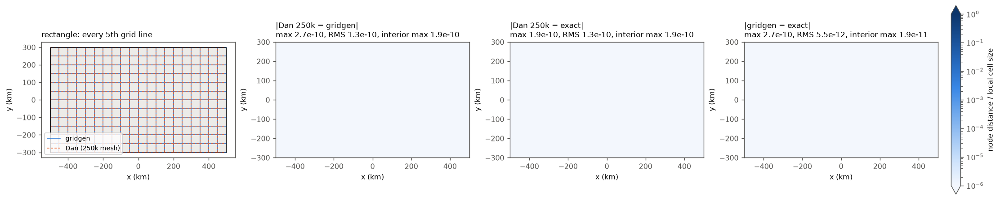
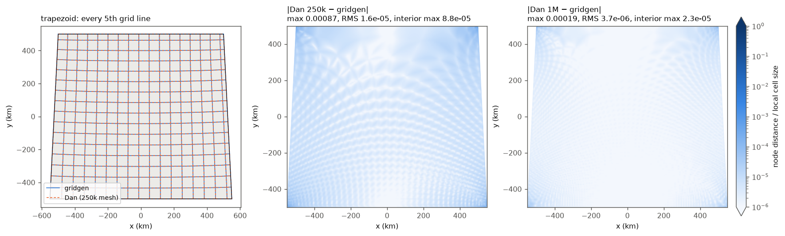
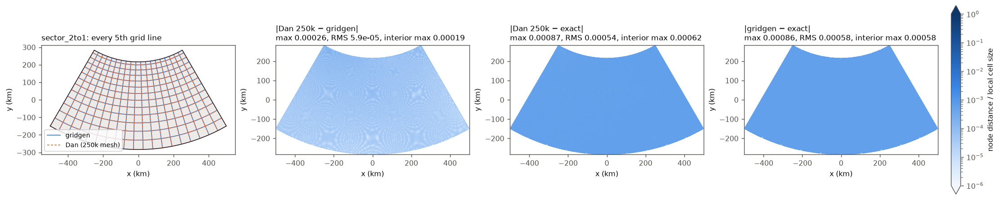
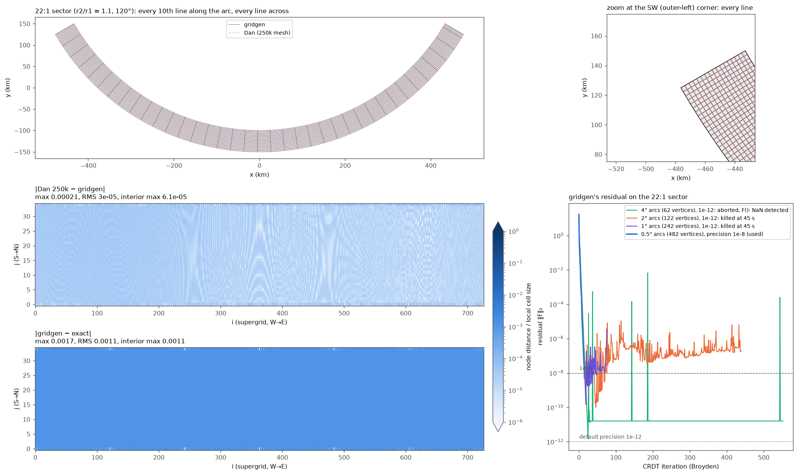
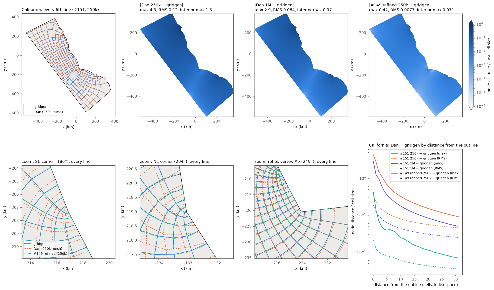

# 04b — gridgen vs Dan's solver, head to head

**Summary.**
- **Same polygon, same plane, same nodes.** On the rectangle, the trapezoid and both annulus sectors, Dan's solver (PR #151, default 250k mesh) matches gridgen to within $3\times10^{-4}$ of a cell everywhere ($9\times10^{-4}$ on the trapezoid's edge) and to $6\times10^{-5}$ of a cell RMS. The conformal moduli agree to about $10^{-7}$ relative or better.
- **The gap is Dan's discretisation error.** It shrinks about 4× when the mesh goes from 250k to 1M points (second order). gridgen's CRDT residual is $10^{-13}$.
- **No crowding on the 22:1 sector.** Dan's solver is as accurate there as anywhere: $2\times10^{-4}$ cell max, modulus to $1.5\times10^{-8}$.
- **California is the outlier.** #151 differs from gridgen by 0.12 cells RMS. The worst node, next to the 204° NE corner, is 4.3 local cells (15.7 km) off. Even 20 cells from every corner the difference is still up to 0.3 cells, and 4× more mesh points only halve it. Interior orthogonality p99/max is 2.6°/40° for #151 against 0.16°/3.1° for gridgen.
- **Dan's corner refinement from #149 (planned as PR 2b) closes most of that gap:** 0.0077 cells RMS, modulus to $4\times10^{-7}$, p99 0.36°. gridgen is an independent check that PR 2b is needed and an accuracy target for it.
- **Exact answers.** Both solvers reproduce the rectangle to $10^{-10}$ cells. On the sectors both sit on the same floor, about $10^{-3}$ cells from the exact $\log z$ map, which comes from polygonising the arcs at 0.5°, not from either solver.
- **gridgen has practical problems.** At its default `precision=1e-12` it **does not finish** on the 22:1 sector. The residual stalls above 1e-12, and the C loop has no iteration cap, so the call either runs forever or ends in gridgen's own NaN error, which calls `exit(1)` and kills the Python process. I used `precision=1e-8`. Even on a 62-vertex version, the outcome changes with vertex changes of 1 nm.
- **Cost.** Dan's solver takes 2–3 s at 250k and 13–21 s at 1M, whatever the vertex count. gridgen takes 2–7 s on the 4- and 30-vertex outlines and 44 s and 90 s on the 242- and 482-vertex sectors.
- **Boundary fit.** Both put boundary nodes on the outline: Dan to $10^{-8}$ m by snapping, gridgen to $10^{-6}$–$10^{-5}$ m by construction. gridgen returned no NaN or masked nodes.

Reproduce everything with `gridgen_vs_dan.ipynb` (dev_gridgen kernel, about 9 minutes). Background is in [02](02_gridgen_method.md) (gridgen) and [03](03_dans_method.md) (Dan's method).

---

## 1. Setup common to all cases

**One plane.** Every synthetic outline is built in metres in the fixed Lambert conformal plane `MapProjection("lcc", -100, 35, 33, 37)`, the one `tests/test_conformal.py::get_rectangle` uses. Dan's `solve` needs lon/lat, so the outline is unprojected and passed in with that projection. `solve` projects it straight back, with a round-trip error of about $10^{-9}$ m. gridgen gets the same $x, y$ in km. California is projected with `cf.projection_for("lcc", lon, lat)`, and both solvers see that plane. Both therefore solve the same straight-sided polygon.

**Dan's solver without the package.** `mom6_forge/_conformal.py` is loaded from the worktree by file path (`importlib.util.spec_from_file_location`). The California grid it gives in `dev_gridgen` (numpy 2.5, scipy 1.18) is **bit-identical** to `import mom6_forge._conformal` in `dev_mf` (numpy 2.4, scipy 1.17), with the same aspect `3.055595056133761` and a node difference of 0.0 m.

**Matching orientation and nodes.**
- Dan reorders the corners SW-first (smallest $x+y$), then counter-clockwise. His supergrid `x[j, i]` runs S→N in `j` and W→E in `i`.
- gridgen's `ul_idx` vertex becomes the upper-left corner of its image rectangle. The side after it (going CCW) becomes the image's left side, and lattice row 0 is the image's bottom.
- Passing **`ul_idx = cg.corners[3]`** (Dan's NW corner) therefore gives gridgen left = Dan's W and bottom = Dan's S.
- With **`shape = (2 ny + 1, 2 nx + 1)`** (pygridgen's shape counts *nodes*), gridgen's `x[j, i]` is Dan's supergrid node `[j, i]`. Both sample the uniform lattice on the image rectangle, so every supergrid node is compared, about 24k–49k per case.
- The notebook asserts that the four corner nodes of both grids sit on the outline's corners.

**The 1M runs use the 250k cell counts.** `solve` rounds `ny = round(nx · aspect)` from its own aspect. California sits on the rounding edge ($63 \times 3.0555 = 192.5$): the 250k mesh gives 63 × 193 and the 1M mesh would give 63 × 192. For node-by-node comparison the 1M run is forced to 63 × 193 by wrapping `_solve_mesh` to override `nx, ny` only.

**gridgen settings.** pygridgen defaults are `nnodes=14`, `precision=1e-12`, Broyden on and thinning on. β = +1 at the 4 corners and 0 at every other vertex. The one exception is `precision=1e-8` on the 22:1 sector (§6). gridgen is called twice on one object: a 3×3 lattice from cold, which times the CRDT solve and prints the image corners to 15 digits at `verbose=2`, then the full lattice warm-started from the cached σ, which times the node mapping.

**Measures.**
- **Node distance.** In units of the **local cell size** $h$: twice the geometric mean of the two supergrid spacings at that node, taken from the exact grid where known and from gridgen otherwise. "Interior" means at least 2 cells (4 supergrid nodes) from the outline.
- **Orthogonality.** Deviation from 90° at interior cell corners (q-nodes), using the supergrid neighbours half a cell away.
  - For curved grids this stencil has an $O(h^2)$ error of its own, which is the same for both solvers. On the exact sector grid it reads $10^{-12}$°.
  - "Near corners" is the worst of the 3×3 interior q-nodes nearest each corner.
  - "Boundary" is the q-nodes on the sides. It uses a second-order one-sided difference inward, because a plain one-sided step reads 0.16° even on the exact sector grid.
- **Boundary fit.** The largest distance of any outer-row or outer-column node from the outline polygon.

---

## 2. How to run pygridgen yourself

- **Environment:** `conda run -n dev_gridgen python -I ...`, or the kernel `/glade/work/manishrv/conda-envs/dev_gridgen/bin/python`. It has pygridgen 0.3.0 from conda-forge. `setuptools<81` is pinned because `pygridgen/tests/__init__.py` imports `pkg_resources`, which setuptools 81 removes. The import still prints a deprecation warning.
- **`shape=(ny, nx)` counts nodes, not cells**, whatever the docstring says. For Dan's supergrid pass `(2*ny+1, 2*nx+1)`.
- **Orientation:**
  - `ul_idx` must be a +1 corner. It becomes the image's upper-left, the next side (CCW) is the image's left side, and row 0 is the image's bottom.
  - To line up with Dan, use his NW corner, `cg.corners[3]`, on a CCW outline.
  - A clockwise outline is reversed inside gridgen, so check the corner nodes rather than trusting indices.
- **The modulus.**
  - It is only printed, at `verbose=1`, as `conformal modulus = %.5g`, and it is the image's **width/height**. With the orientation above that is **1 / Dan's `aspect`**.
  - Square cells need $(n_x-1)/(n_y-1) \approx$ modulus. That checks out with `Gridgen([0,4,4,0],[0,0,2,2],[1]*4,shape=(11,21),ul_idx=3)`, which prints 2 and gives 0.2 × 0.2 cells. gridgen's README says the reverse.
  - For more digits, use `verbose=2` and read the `image corners:` block printed after `aligning:`.
- **The log goes to C's stderr (file descriptor 2), not Python's `sys.stderr`.** In Jupyter it lands in the terminal that started the kernel. To capture it, `os.dup2` a temporary file onto fd 2 around the call (`CaptureStderr` in the notebook).
  - During mapping, `verbose=1` prints one character per node: `.` means the secant inversion worked, `o` means it fell back to the ODE, and `-` means it failed and the node is NaN.
  - At `verbose=2` the CRDT residual is printed every iteration as `k: error = ...`.
- **The CRDT loop has no iteration cap, and Ctrl-C can't stop it**: the interrupt is only handled after the ctypes call returns, so you have to restart the kernel.
- **gridgen's error handler calls `exit(1)`** (e.g. "F(): NaN detected"), which kills the Python process or the Jupyter kernel with no exception.
- If a solve might not converge, run it in a subprocess with a timeout and check the return code, as the notebook's stall demonstration does. On elongated outlines loosen `precision` (1e-8 worked here). `precision` is also gridgen's tolerance for inversion, the ODE and snapping.
- **Reuse σ.** Set `g.ny, g.nx = ...` on an existing `Gridgen` and call `g.generate_grid()`. The CRDT solve is warm-started from the cached σ (one residual evaluation), so only the node mapping is paid for again.
- **Units.** I passed km (the outlines are 100–1000 km). I didn't test whether metres behave differently.
- **NaNs and units out.** NaN nodes come back as `numpy.ma` masked arrays; none appeared here. Coordinates come back in whatever units you passed in. `nppe` is ignored by the C library ([02 §2.8](02_gridgen_method.md)).

---

## 3. Rectangle, 1000 × 600 km

**Setup.** A true rectangle in the plane, with corners as given. 100 × 60 cells of 10 km, 24,321 supergrid nodes. Exact answer: uniform squares, `aspect` = 0.6, gridgen modulus = 1.6667.

| | aspect (ny/nx) | rel. error | max node distance vs exact (cells) | interior ortho max | boundary fit |
|---|---|---|---|---|---|
| Dan 250k | 0.60000000 | $-4\times10^{-14}$ | $1.9\times10^{-10}$ (1.9 µm) | $4\times10^{-11}$° | 1.4e-9 m |
| Dan 1M | 0.60000000 | $-2\times10^{-12}$ | $1.5\times10^{-10}$ | $1.3\times10^{-10}$° | 1.4e-9 m |
| gridgen | 0.60000000 (printed 1.6667) | $4\times10^{-15}$ | $2.7\times10^{-10}$ (outer ring), $2\times10^{-11}$ interior | $6\times10^{-9}$° | 1.6e-6 m |

Both are exact to rounding. Dan's P1 elements reproduce the linear exact $\xi, \eta$ exactly. Dan − gridgen is at most $2.7\times10^{-10}$ cells.

*The distance maps are blank because every value is below the colour scale's $10^{-6}$ floor.*

---

## 4. Trapezoid, 10% wider at the bottom

**Setup.** Bottom side 1100 km, top side 1000 km, height 1000 km, as in `test_straight_sides_have_smooth_edge_cells`. 82 × 78 cells of 12.8 km. There is no closed form, so gridgen (residual $10^{-14}$) is the reference.

| | aspect | vs gridgen (rel.) | Dan − gridgen max / RMS (cells) | interior max | ortho p99 / max | boundary ortho p99 |
|---|---|---|---|---|---|---|
| Dan 250k | 0.95370268 | $1.3\times10^{-9}$ | $8.7\times10^{-4}$ / $1.6\times10^{-5}$ (9.6 m) | $8.8\times10^{-5}$ | 0.0038° / 0.073° | 0.10° |
| Dan 1M | 0.95370268 | $4.4\times10^{-10}$ | $1.9\times10^{-4}$ / $3.7\times10^{-6}$ (2.1 m) | $2.3\times10^{-5}$ | 0.0040° / 0.079° | 0.084° |
| gridgen | 0.95370268 (printed 1.0485) | – | – | – | 0.0041° / 0.078° | 0.079° |

- The largest difference is on the N side next to the NW and NE corners, where the corner angles are 92.9°.
- The interior difference is $10^{-4}$ cells and falls 3.8× (interior max) and 4.0× (interior RMS) from 250k to 1M: Dan's solve converging to gridgen's.
- The orthogonality numbers are the stencil's own truncation on these curved lines, the same for both solvers.

---

## 5. Annulus sector, moderate: $r_2/r_1 = 2$, Δθ = 60°

**Setup.**
- $r_1 = 500$ km, $r_2 = 1000$ km. Each arc is polygonised at 0.5°, giving 242 vertices (gridgen splits them to 266).
- The sector opens downward: S = outer arc, N = inner arc, W/E = the radial edges.
- 95 × 63 cells, with a median cell of 7.8 km.
- Exact map, from $w=\log(z-c)$: $\xi=(\theta-\theta_1)/\Delta\theta$, $\eta=\ln(r_2/r)/\ln(r_2/r_1)$, and `aspect` $=\ln 2/(\pi/3)=0.66190680$.

| | aspect | vs exact (rel.) | vs gridgen (rel.) |
|---|---|---|---|
| Dan 250k | 0.66190687 | $+9.8\times10^{-8}$ | $+1.2\times10^{-7}$ |
| Dan 1M | 0.66190681 | $+1.0\times10^{-8}$ | $+2.9\times10^{-8}$ |
| gridgen | 0.66190679 (printed 1.5108) | $-1.9\times10^{-8}$ | – |

gridgen's $-1.9\times10^{-8}$ is the polygon's own modulus: the polygonisation error falls as $N^{-3}$ with the number of arc segments (measured at $1.5\times10^{-7}$ with 1° segments).

| node distance (cells) | max | RMS | interior max | interior RMS |
|---|---|---|---|---|
| Dan 250k − gridgen | $2.6\times10^{-4}$ (1.8 m) | $5.9\times10^{-5}$ | $1.9\times10^{-4}$ | $5.7\times10^{-5}$ |
| Dan 1M − gridgen | $1.5\times10^{-4}$ (0.8 m) | $1.6\times10^{-5}$ | $4.7\times10^{-5}$ | $1.4\times10^{-5}$ |
| Dan 250k − exact | $8.7\times10^{-4}$ (9.5 m) | $5.4\times10^{-4}$ | $6.2\times10^{-4}$ | $5.4\times10^{-4}$ |
| gridgen − exact | $8.6\times10^{-4}$ (9.5 m) | $5.8\times10^{-4}$ | $5.8\times10^{-4}$ | $5.8\times10^{-4}$ |

**Reading it.**
- Both grids are $\approx 6\times10^{-4}$ cells (up to 9.5 m) from the exact log-polar grid, *everywhere*, not only at the boundary. 9.5 m is the sagitta of a 0.5° chord at $r = 1000$ km. The polygon's chords cut a little off the region, and that shifts the whole map by about a sagitta.
- Against the exact map, the two solvers are therefore indistinguishable. Against each other, on the polygon they both solve, they agree to $6\times10^{-5}$ cells RMS, 4× closer at 1M.

| orthogonality (°) | interior p50 | p99 | max | near the 4 corners | boundary p99 / max |
|---|---|---|---|---|---|
| Dan 250k | $9\times10^{-4}$ | 0.0076 | 0.013 | ≤ 0.0039 | 0.078 / 0.086 |
| Dan 1M | $2\times10^{-4}$ | 0.0018 | 0.0025 | ≤ 0.0014 | 0.079 / 0.080 |
| gridgen | $6\times10^{-12}$ | 0.00036 | 0.00039 | 0.00039 | 0.080 / 0.080 |
| exact (true arcs) | $3\times10^{-13}$ | $10^{-12}$ | $2\times10^{-12}$ | $10^{-12}$ | $2\times10^{-6}$ |

- gridgen's grid is orthogonal to machine precision in the interior. The 0.0004° near its corners is real: the polygon's corners are 90° ± 0.25°, because the first chord leaves the radial edge at half a segment angle.
- The 0.08° on the arcs is the polygon's 0.5° kinks, and it is the same for both solvers.
- Dan's interior error is 0.01°, 4× smaller at 1M: P1 interpolation error.

---

## 6. Annulus sector, elongated: $r_2/r_1 = 1.1$, Δθ = 120° (22:1)

**Setup.**
- $r_1 = 500$ km, $r_2 = 550$ km. The arcs are 0.5° segments, giving 482 vertices (486 after gridgen's splitting).
- 363 × 17 cells, median cell 3.0 km.
- Exact `aspect` $=\ln 1.1/(2\pi/3)=0.045507259$, which is a gridgen modulus of 21.975.
- This is the regime where plain Schwarz–Christoffel crowds and CRDT is needed ([02 §1.6–1.7](02_gridgen_method.md)).

| | aspect | vs exact (rel.) | vs gridgen (rel.) | max node distance vs gridgen (cells) | interior RMS |
|---|---|---|---|---|---|
| Dan 250k | 0.045507252 | $-1.50\times10^{-7}$ | $-1.5\times10^{-8}$ | $2.1\times10^{-4}$ (0.6 m) | $2.5\times10^{-5}$ |
| Dan 1M | 0.045507252 | $-1.39\times10^{-7}$ | $-3.8\times10^{-9}$ | $1.1\times10^{-4}$ (0.3 m) | $6.4\times10^{-6}$ |
| gridgen (`precision=1e-8`) | 0.045507253 (printed 21.975) | $-1.35\times10^{-7}$ | – | – | – |

- All three are $1.1\times10^{-3}$ cells (max $1.7\times10^{-3}$, 5.2 m) from the exact map. This is the same polygon floor as in §5, here the sagitta at 550 km.
- Dan − gridgen is 8× below that floor and falls 4× from 250k to 1M.
- Orthogonality: interior p99 0.0044° for Dan 250k, 0.0039° for Dan 1M and 0.0040° for gridgen. All three come from the 89.75°/90.25° polygon corners. gridgen's median is $10^{-7}$°.
- **Dan's solver shows no crowding.** It has no prevertices and no disc, only a mesh of the shape; it took 2.6 s.

**gridgen did not finish at its default precision.** It stops only when the CRDT residual drops below `precision`, and the loop has no iteration cap.

| arc segments (vertices) | precision | outcome |
|---|---|---|
| 4° (62) | 1e-12 | **aborted** after 553 iterations. The residual sat at $1.6\times10^{-11}$ for about 500 iterations, then gridgen stopped with "F(): NaN detected" and `exit(1)`. Run in-process, that would have killed the Python process. A version of the same polygon whose vertices differ by $8\times10^{-10}$ m (a different floating-point route to the same arc points) converges cleanly in 27. |
| 4° (62), 10 copies with vertices perturbed by $10^{-13}$ relative (about 0.05 mm) | 1e-12 | 9 converged (exit code 0) in 26–72 iterations; 1 was still iterating after 30 s (about 1300 iterations) |
| 2° (122) | 1e-12 | killed after 45 s and about 440 iterations, residual wandering $7\times10^{-8}$ to $6\times10^{-6}$ (an earlier run passed 700 iterations without converging) |
| 1° (242) | 1e-12, 1e-10 | killed; the residual never went below about $10^{-8}$ (160+ iterations at 1e-10) |
| 0.5° (482), used | 1e-8 | 16 iterations, 47.0 s solve + 42.4 s node mapping |

The residual stalls at about $10^{-8}$ (figure, bottom right). With more vertices along the long sides, each CRDT embedding holds more crowded prevertices far from its own quadrilateral, so the residual itself is noisy at that level. Broyden then wanders instead of converging. CRDT keeps the *map* accurate (gridgen − exact sits on the polygon floor, like Dan's), but **the stopping rule assumes a residual floor that this geometry doesn't have**. For pygridgen users that means a call that hangs with no error, or one that takes the interpreter down. No node failed: 1,506 of 25,445 nodes needed the ODE fallback for inversion, and none came back NaN.

*Middle and bottom left: node distances in index space (i along the arc, j across). The bottom map is a flat $10^{-3}$: the polygon floor. The Dan − gridgen map shows the mesh's interpolation pattern at $10^{-5}$–$10^{-4}$. Bottom right: the residual histories.*

---

## 7. California (`tests/data/california_bays.outline.json`)

**Setup.**
- 30 vertices, with corners [0, 6, 22, 29]. Dan orders them SW, SE, NE, NW with angles 86°, 186°, 204° and 80°.
- Projected with `projection_for("lcc", lon, lat)`. β = +1 at the corners and 0 elsewhere. gridgen has 32 vertices after splitting.
- 12,000 cells, giving 63 × 193 (supergrid 387 × 127 = 49,149 nodes), median cell 4.1 km.
- The most reflex non-corner vertex is #5 (249°).
- Also run: **Dan's #149 solver with corner refinement**, read with `git show 55e7010b:mom6_forge/_conformal.py` and run at 250k with the same 63 × 193 cells. #151 strips that refinement out; ROADMAP plans it as PR 2b.

| | aspect (ny/nx) | vs gridgen (rel.) | ny it would choose for 12k cells |
|---|---|---|---|
| #151 250k | 3.05559506 | $+4.1\times10^{-5}$ | 193 |
| #151 1M | 3.05552187 | $+1.7\times10^{-5}$ | 192 |
| #149 refined 250k | 3.05546735 | $-3.8\times10^{-7}$ | 192 |
| gridgen | 3.05546851 (printed 0.32728) | – | $63 \times 3.05547 = 192.49$ → 192 |

| node distance vs gridgen (cells) | max | RMS | interior max | interior RMS | max (km) |
|---|---|---|---|---|---|
| #151 250k | 4.28 | 0.117 | 1.50 | 0.085 | 15.7 |
| #151 1M | 2.87 | 0.064 | 0.97 | 0.047 | 11.6 |
| #149 refined 250k | 0.42 | 0.0077 | 0.071 | 0.0060 | 1.7 |

All three maxima are at the N-side node next to the 204° NE corner, supergrid (386, 125), where the local cell is 3.7 km.

The next table leaves out nodes within $k$ cells of any corner, to show how far the corner disagreement reaches:

| $k$ (cells) | #151 250k max / RMS | #151 1M max / RMS | #149 refined max / RMS |
|---|---|---|---|
| 0 | 4.28 / 0.117 | 2.87 / 0.064 | 0.42 / 0.0077 |
| 5 | 1.07 / 0.086 | 0.56 / 0.047 | 0.12 / 0.0062 |
| 10 | 0.50 / 0.072 | 0.34 / 0.040 | 0.12 / 0.0055 |
| 20 | 0.32 / 0.058 | 0.23 / 0.032 | 0.023 / 0.0045 |

| orthogonality (°) | interior p50 | p99 | max | near SE (186°) / NE (204°) | near reflex vertex #5 | boundary p99 / max | boundary fit |
|---|---|---|---|---|---|---|---|
| #151 250k | 0.031 | 2.6 | 39.8 | 21 / 40 | 3.8 | 34 / 45 | 4e-9 m |
| #151 1M | 0.017 | 1.5 | 31.0 | 31 / 30 | 0.85 | 16 / 66 | 4e-9 m |
| #149 refined 250k | 0.0042 | 0.36 | 7.7 | 2.7 / 7.7 | 0.74 | 5.8 / 11.6 | 4e-9 m |
| gridgen | 0.0012 | 0.16 | 3.1 | 0.15 / 0.79 | 0.73 | 3.6 / 10.4 | 2e-6 m |

"Near SE/NE" is the worst of the 3×3 interior cell corners nearest that corner. Near the singular points every finite-difference angle includes some stencil error, gridgen's too. That is why even gridgen reads 3° somewhere.

**Reading it.**
- **The corner singularity spoils #151's whole grid, not just the corner cells.**
  - At the 186° and 204° corners a Dirichlet side meets a zero-flux side at more than 90°. There the exact $\xi$ or $\eta$ behaves like $r^{90°/\alpha}$, which is $r^{0.44}$ at 204°.
  - A uniform P1 mesh can't resolve that. The error then spreads through the domain (finite-element "pollution"), and it converges only at about first order: 0.117 → 0.064 RMS for a 2× finer $h$.
  - It moves the modulus by $4\times10^{-5}$. That is enough to tip ny from 192 to 193, since $63 \times M$ sits at 192.49.
- **#149's refinement fixes most of it.** It halves the mesh spacing up to 5 times near the sharp vertices. The result is 15× closer to gridgen in RMS, the modulus agrees to $4\times10^{-7}$, and it takes 2.2 s against 1.9 s.
  - The converged modulus recorded in this directory's `CLAUDE.md` (from refining Dan's mesh) is 3.05547; gridgen gives 3.05546851 independently.
  - This reproduces ROADMAP's PR 2b motivation table (unrefined p99/max 2.3°/34°, refined 0.46°/3.0°, measured there with a different stencil) against an outside reference.
- **The 249° reflex vertex is mild by comparison.** Within 3 cells of it #151 at 250k reaches 3.8°, and #151 1M, #149 and gridgen all reach about 0.75°.
- **Zooms (bottom row).**
  - At the SE and NE corners, #151's lines (orange, dashed) visibly miss gridgen's (blue).
  - #149's (green, dotted) lie on gridgen's.
  - At the reflex vertex all three coincide.

*Top: the overlay (every 6th line; at this scale the grids coincide) and the three node-distance maps. Bottom: zooms at the 186° and 204° corners and at the 249° reflex vertex, every line. Last panel: Dan − gridgen against distance from the outline.*

---

## 8. Timing (one core, crlogin2)

| case | supergrid nodes | Dan 250k | Dan 1M | gridgen CRDT solve | gridgen node mapping | gridgen iterations / final residual |
|---|---|---|---|---|---|---|
| rectangle (4 vertices) | 24,321 | 2.1 s | 15.1 s | 0.0 s | 2.0 s | 7 / 6e-15 |
| trapezoid (4) | 25,905 | 2.3 s | 15.7 s | 0.0 s | 2.1 s | 5 / 1e-14 |
| sector 2:1 (266 after splitting) | 24,257 | 2.8 s | 20.7 s | 18.2 s | 25.6 s | 19 / 3e-13 |
| sector 22:1 (486) | 25,445 | 2.6 s | 12.6 s | 47.0 s | 42.4 s | 16 / 5e-9 (precision 1e-8) |
| California (32) | 49,149 | 1.9 s | 13.8 s | 0.2 s | 7.2 s | 22 / 3e-13 |

- Dan's cost depends on mesh size and hardly at all on the outline.
- gridgen's solve grows about as $n^2$ in the vertex count: 0.3, 1.2 and 4.4 s for 40, 74 and 138 vertices on the 2:1 sector. Its mapping costs $O(n)$ per node, about 1–2 ms per node at 250–500 vertices.
- A real coastline with hundreds of vertices would cost gridgen minutes, and with no guarantee that it terminates.

---

## 9. What this tells a reviewer

1. **The finite-element idea in #151 is sound.** Where the map has no singularity worse than a 90° grid corner, it reproduces an independent Schwarz–Christoffel solution to $10^{-4}$–$10^{-3}$ of a cell, and converges at second order as the mesh is refined. It has no trouble on a 22:1 domain where SC methods need CRDT.
2. **Without corner refinement, #151 is not accurate on the PR's own California fixture.**
   - It is 0.12 cells RMS from the reference, the nodes next to the 186°/204° corners are off by kilometres, and orthogonality is p99 2.6° / max 40° against 0.16° / 3.1° for gridgen.
   - The errors are not confined to the corner cells: 0.3 cells remain 20 cells away.
   - #149's refinement brings this to 0.008 cells RMS. That is strong evidence that PR 2b should follow soon, and gridgen gives it a concrete target.
   - Until then, a user grid with reflex or obtuse corners from #151 is noticeably less conformal than the docstrings suggest. `ConformalGrid.h` still says "finer round singular vertices" (02 §5 row 16).
3. **The `ny` rounding edge is real but harmless.** California's 63 × 193 comes from a modulus that is $4\times10^{-5}$ high. The converged modulus gives 63 × 192. The test's ±3 tolerance on `(nx, ny)` is the right call.
4. **An exact, dependency-free accuracy test is available.** An annulus sector, $w = \log z$, pins the modulus to about $10^{-7}$ and the nodes to about $10^{-3}$ of a cell at 0.5° arcs, at a cost of about 3 s. Today's tests check the rectangle (where P1 elements are trivially exact) and California's structure, but nothing that is exact *and* curved.
5. **gridgen is a good offline reference, not a better engine for this tool.**
   - It is more accurate at singular corners, because its quadrature handles the corner exponents exactly.
   - But it has no iteration cap, needs a hand-tuned `precision` on elongated outlines, and only terminates by luck at the default precision on such outlines.
   - Its cost grows quadratically with the number of outline vertices.
   - Dan's linear solve always returns in a few seconds.
6. **Boundary handling is equivalent.** Both put boundary nodes on the outline to within micrometres, Dan by explicit arc-length snapping and gridgen by construction. The corners are exact in both.

## 10. Caveats

- The "exact" sector answers are for the true arcs. Both solvers solve a 0.5° polygon, so their distance from exact has a floor of $\sim 10^{-3}$ cells, which no solver can beat. Finer arcs cost gridgen $O(n^2)$ and run into the convergence problem in §6.
- On the trapezoid and California, gridgen is treated as the truth. Its residual is $10^{-13}$, it matched the exact rectangle to $10^{-10}$ cells, and Dan's refined and finer solves converge towards it. It is still a numerical method, though.
- All orthogonality numbers are finite-difference angles at discrete nodes. Near singular points they include stencil error, which is why gridgen's own grid reads 3° near California's corners.
- Timings are single runs on a shared login node.
